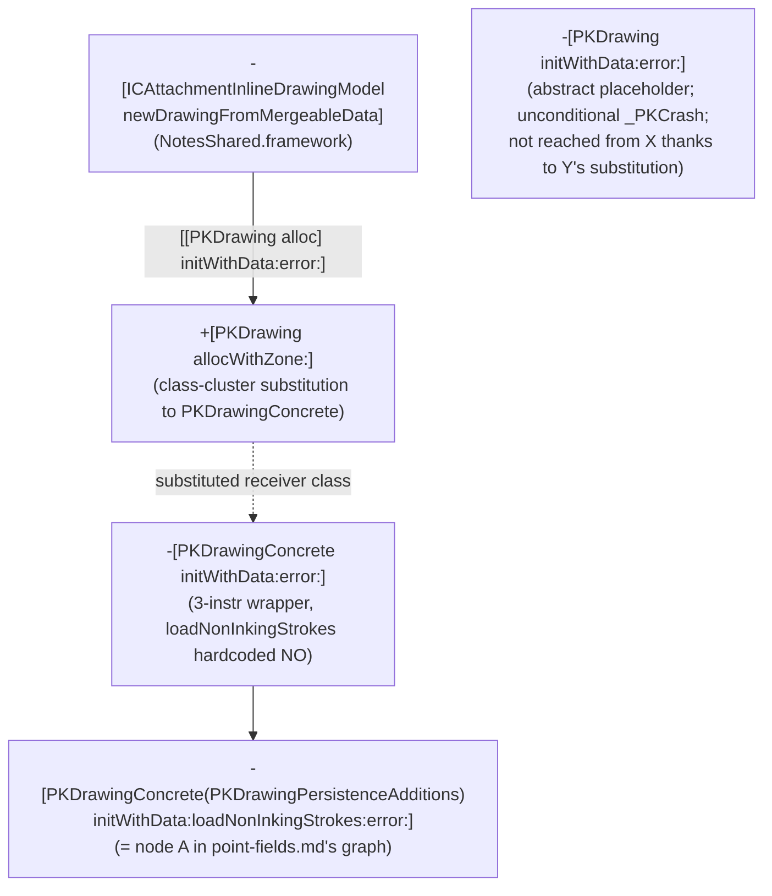

# Finding the real Notes-side caller of PencilKit's `com.apple.drawing.2` parser

`envelope.md` and `point-fields.md` in this directory both start from
`-[PKDrawingConcrete(PKDrawingPersistenceAdditions)
initWithData:loadNonInkingStrokes:error:]` in `PencilKit.framework`, chosen
purely because the selector name sounded plausible for the job - that choice
was never actually verified from the caller side. Separately,
`legacy_drawing.md` found a whole second, structurally unrelated C++
protobuf-parser namespace (`legacy_drawing::*`, reached via
`-[PKDrawingConcrete(PKDrawingPersistenceAdditions) initWithLegacyData:]`)
and left open whether it's dead code, a wholly separate historical format, or
actually still reachable for some subset of `com.apple.drawing.2` blobs
(e.g. via a version/UTI-based branch upstream). This file closes both loops
by working from `NotesEditor.framework` - the framework that owns the Notes
UI/model classes for drawing attachments - down into PencilKit, rather than
starting inside PencilKit and guessing.

## Summary of findings

1. The actual call chain Notes uses to turn attachment bytes into a drawing
   object is confirmed, and it **does** go through
   `initWithData:loadNonInkingStrokes:error:` - the function `envelope.md`
   already traced - but by way of two thin wrapper layers neither prior file
   examined: `-[ICAttachmentInlineDrawingModel newDrawingFromMergeableData]`
   and `-[PKDrawingConcrete initWithData:error:]`.
2. The real implementation of `newDrawingFromMergeableData` lives in
   **`NotesShared.framework`**, not `NotesEditor.framework` - a correction to
   this session's own starting assumption. `NotesEditor.framework` does
   reference the selector (confirmed via its own `objc_msgSend$` stub table),
   consistent with its UI classes (`ICDrawingInlineAttachmentView`,
   `ICDrawingInlineView`, `ICLayoutManager`) driving an
   `ICAttachmentInlineDrawingModel` instance whose class is defined in
   NotesShared, but the exact call site inside NotesEditor was not isolated
   this session (see "Not concluded").
3. No UTI-based or version-based branch to `initWithLegacyData:` /
   `legacy_drawing::*` was found anywhere in this call chain.
   `initWithLegacyData:` is not referenced at all - not even the bare
   `objc_msgSend$initWithLegacyData:` selector-reference stub - anywhere in
   any of the five Notes-side framework binaries checked (NotesEditor,
   NotesShared, NotesSupport, NotesHTML, PaperKit). This is evidence, not
   proof (see caveats below), that the `legacy_drawing::*` family is not on
   the live `com.apple.drawing.2` read path from Notes.app.

## Methodology / call chain, in order examined

### 1. `nm -U NotesEditor | grep -iE "drawing|mergeable"`

Broad grep, same technique `envelope.md` used against PencilKit. Most hits
are ordinary AppKit view/controller plumbing
(`ICDrawingInlineAttachmentView`, `ICDrawingInlineView`, `ICLayoutManager`).
The useful signal was in the `objc_msgSend$<selector>` stub-reference list at
the bottom of the `nm` output (these list every selector *sent* from the
binary, not just ones *implemented* in it): `newDrawingFromMergeableData` and
`typeUTIIsInlineDrawing:` stood out as exactly the "given raw bytes, produce
a drawing" and "is this attachment's UTI a drawing type at all" operations
this session was looking for.

### 2. `-[ICAttachmentInlineDrawingModel newDrawingFromMergeableData]`

Grepping all six extracted frameworks (`NotesEditor`, `PencilKit`,
`PaperKit`, `NotesShared`, `NotesSupport`, `NotesHTML`) for this selector's
*implementation* (as opposed to reference) found exactly one: `NotesShared`.
Disassembled via `ipsw macho disass NotesShared -s
"-[ICAttachmentInlineDrawingModel newDrawingFromMergeableData]" --demangle
--force`.

Confirmed shape: sends `attachment` to `self`, then `mergeableData` to the
result (an `NSData`, matching this session's background assumption about
`ZICCLOUDSYNCINGOBJECT.ZMERGEABLEDATA1`). If the data's `length` is zero,
returns `nil` immediately - no PencilKit call happens at all for empty data.
Otherwise, it loads a class reference and calls (in ObjC-message-send terms)
`[[<class> alloc] initWithData:<mergeableData> error:&error]`. The class
reference is a plain `adrp`/`ldr` load from a fixed data-section slot that
`ipsw`'s disassembler did not annotate by name; its target address was
independently resolved with `ipsw dyld a2s <shared-cache-path> <address>`
(address-to-symbol lookup directly against the live shared cache on the
source Mac, a different technique from anything used in the other three
files here) and reported as `_ptr._OBJC_CLASS_$_PKDrawing` - i.e. the class
being alloc'd is **`PKDrawing`**, PencilKit's public-facing drawing class,
not `PKDrawingConcrete` directly.

If `initWithData:error:` returns a non-nil `error`, the function logs via
`os_log` with subsystem string `"com.apple.notes"` and category string
`"PencilKit"` (both literal `cstring` operands visible directly in the
disassembly) before returning `nil`. There is no fallback to any other
init method, no UTI check, and no version check in this function - it always
calls the same `PKDrawing alloc/init` pair regardless of what's actually in
the bytes.

### 3. `+[PKDrawing allocWithZone:]` - class-cluster indirection

Disassembled via `ipsw macho disass PencilKit -s "+[PKDrawing
allocWithZone:]" --demangle --force`. Confirmed: this override compares the
class actually being allocated (`self` at entry, via a helper call) against
`PKDrawing` itself. If they match - i.e. someone called `[PKDrawing alloc]`
or `[PKDrawing allocWithZone:]` directly, as `newDrawingFromMergeableData`
does - the function substitutes a *different* class reference,
`_OBJC_CLASS_$_PKDrawingConcrete` (visible directly as a `__got` load with
that exact annotated name), and tail-calls `allocWithZone:` again against
`PKDrawingConcrete` instead. If they don't match (some other class calling
through this same override, i.e. a genuine subclass of `PKDrawing` other
than `PKDrawingConcrete`), it instead builds an argument list and calls an
unnamed helper - consistent with an assertion/exception-raising path, not
disassembled further - so this branch was not fully characterized, but the
net effect for `newDrawingFromMergeableData`'s call (which goes through
`PKDrawing` directly) is unambiguous: **the real allocated class is
`PKDrawingConcrete`**, matching a standard Objective-C class-cluster
pattern (`PKDrawing` as the public abstract front, `PKDrawingConcrete` as
the real implementation - the same `PKDrawingConcrete` class all three prior
files' functions are methods on).

### 4. `-[PKDrawing initWithData:error:]` - confirms `PKDrawing` is never directly init'd

Also disassembled, per this session's scope (task explicitly allowed peeking
into `initWithData:error:` as "a small, cheap thing to check"). This is the
base/abstract class's own implementation of the method, as opposed to
`PKDrawingConcrete`'s (next section). It is three instructions: move an
argument into `x0`, call one helper, then unconditionally call `_PKCrash` -
i.e. this implementation always crashes. It is consistent with a
class-cluster "abstract method, must be overridden / must go through
`allocWithZone:`'s substitution" placeholder, and further confirms that
`newDrawingFromMergeableData`'s call - which does *not* crash in practice -
must be dispatching to `PKDrawingConcrete`'s override (§5 below), not this
one, thanks to §3's class substitution.

### 5. `-[PKDrawingConcrete initWithData:error:]` - the missing link

Disassembled via `ipsw macho disass PencilKit -s "-[PKDrawingConcrete
initWithData:error:]" --demangle --force`. This function is exactly three
instructions: move the incoming `error` out-parameter register into the
position `initWithData:loadNonInkingStrokes:error:` expects it, set the
`loadNonInkingStrokes` `BOOL` argument to a hardcoded immediate `0` (`NO`),
and tail-branch (`b`, not `bl` - a genuine tail call, not a call-then-return)
directly into `_objc_msgSend$initWithData:loadNonInkingStrokes:error:`. This
is a plain thin wrapper, confirming exactly the kind of relationship this
session's background section anticipated as one possibility - and it lands
precisely on the function `envelope.md` already fully traced.

**This retroactively confirms `envelope.md`'s original, previously-unverified
assumption**: `initWithData:loadNonInkingStrokes:error:` genuinely is on the
real Notes-app read path for `com.apple.drawing.2` data, reached with
`loadNonInkingStrokes` always `NO` when coming from
`ICAttachmentInlineDrawingModel`'s ordinary load path (as opposed to
whatever other call site - not identified in `point-fields.md` either -
passes `YES`).

### 6. `+[ICAttachment typeUTIIsInlineDrawing:]` - the UTI check, and why it's not a dispatch point

Disassembled via `ipsw macho disass NotesShared -s "+[ICAttachment
typeUTIIsInlineDrawing:]" --demangle --force`. Confirmed: this function
wraps the passed-in UTI string in an `ICUTType` object (an internal
Notes-side wrapper class - confirmed exact name from a `__got` annotation,
`_OBJC_CLASS_$_ICUTType`, not the public `UTType`/`UTTypeReference` API
directly, though presumably backed by it) via `typeWithIdentifier:`, then
checks `conformsToType:` against an `ICUTType` built from the literal string
`"com.apple.drawing.2"` (via `exportedTypeWithIdentifier:`). If that check
succeeds, the function returns `YES` immediately. If it fails, it repeats the
exact same two-step check against the literal string `"com.apple.drawing"`
(the base/older UTI, no `.2` suffix) and returns whatever that second
`conformsToType:` call returns.

This is a **boolean membership test only** - "is this attachment's UTI a
drawing, of either the old or new flavor" - used somewhere upstream (not
traced this session) to decide whether to construct an
`ICAttachmentInlineDrawingModel` at all for a given attachment. It has no
branching consequence on *which* decoder gets used afterward:
`newDrawingFromMergeableData` (§2) calls the identical `PKDrawing
alloc`/`initWithData:error:` pair regardless of which of the two UTI strings
matched, and regardless of the envelope's own byte-4 version field
(`envelope.md`). **No UTI-based or version-based branch to a different
PencilKit entry point (`initWithLegacyData:` or anything else) was found
anywhere in this chain.**

### 7. Absence check for `initWithLegacyData:`

`nm -U PencilKit | grep -i initWithLegacyData` confirms the method exists
(`-[PKDrawingConcrete(PKDrawingPersistenceAdditions) initWithLegacyData:]`,
matching `legacy_drawing.md`'s account). Running the same grep, plus a grep
for the bare `_objc_msgSend$initWithLegacyData:` selector-reference stub
(which would appear in any binary that so much as sends this selector, even
without symbolicated call-site details), against all five Notes-side
framework binaries extracted for this investigation (`NotesEditor`,
`NotesShared`, `NotesSupport`, `NotesHTML`, `PaperKit`) returned **zero**
matches in every one of them. Given `nm -U`'s stub-reference list reliably
surfaced `newDrawingFromMergeableData` and `typeUTIIsInlineDrawing:` as
selectors NotesEditor merely *references* (§1) without those being
implemented there, the complete absence of any `initWithLegacyData:`
reference anywhere in these five binaries is reasonably strong circumstantial
evidence that nothing in Notes' own code calls it.

## Not concluded

- The exact call site inside `NotesEditor.framework` that sends
  `newDrawingFromMergeableData` - confirmed only that the selector is
  referenced somewhere in NotesEditor (via its own `objc_msgSend$` stub
  table), not which function sends it.
  `-[ICLayoutManager attachmentInlineDrawingMergeableDataDidChange:]` was
  checked as a plausible candidate (disassembled and its outgoing
  `bl`/`objc_msgSend$` targets enumerated) and does **not** call it directly.
- `+[PKDrawing allocWithZone:]`'s non-`PKDrawing`-self branch (the
  assertion/exception path taken if some third class inherits from
  `PKDrawing`) and `-[PKDrawing initWithData:error:]`'s `_PKCrash` path -
  both observed but not disassembled past the top level; the helper
  addresses they call were not resolved to names.
- Whether `initWithLegacyData:` / `legacy_drawing::*` is reachable from
  *anywhere* in Notes.app's full binary graph, not just the five framework
  binaries grepped this session. Notes.app's own main executable, and any
  other framework it links that wasn't part of this investigation's original
  extraction set, were not checked. The absence finding in §7 is therefore
  scoped to "not called from NotesEditor/NotesShared/NotesSupport/
  NotesHTML/PaperKit," not "not called from anywhere in Notes."
- `ICDrawingVersionedDocument` (`NotesShared`) - a class with
  `serializationVersion`/`minimumSupportedVersion`/`mergeWithDrawingVersionedDocument:`
  methods that sounds relevant to versioning - was noticed in the same `nm`
  pass that looked for `initWithLegacyData:` references, but its actual role
  (almost certainly CRDT-style merge of concurrent drawing edits, not initial
  blob decoding, given the `merge*` method names) was not examined this
  session; out of scope.
- Exact identity of the helper call in `newDrawingFromMergeableData`
  immediately preceding the alloc/init pair (`bl 0x1d9dde4e8` in the
  disassembly) - inferred as `objc_alloc` or equivalent by calling-convention
  shape (receives the class pointer in `x0`, and its result becomes the
  receiver for the following `initWithData:error:` message send with no
  intervening `mov`), not confirmed by symbol name.

## Provenance

- Source Mac: macOS 26.6.2 (build 25G83), Apple Silicon (T8103), examined
  2026-09-11 - same source Mac/OS/build as the other three files in this
  directory.
- Tooling: `otool` (Xcode Command Line Tools), `ipsw` v3.1.714
  (blacktop/ipsw), `nm`, `strings`. Additionally, this session used `ipsw
  dyld a2s <dyld_shared_cache_arm64e path> <address>` (address-to-symbol
  lookup directly against the live shared cache at
  `/System/Cryptexes/OS/System/Library/dyld/dyld_shared_cache_arm64e`) to
  resolve one unannotated class-reference load that `ipsw macho disass`
  itself left uncommented - a tool/technique not used in the other three
  files in this directory.
- Binaries examined: `NotesEditor.framework` (the framework this session
  started from, per its task background), `NotesShared.framework` (where the
  actual `newDrawingFromMergeableData` and `typeUTIIsInlineDrawing:`
  implementations turned out to live - not anticipated at the start of this
  session), and `PencilKit.framework` (for `PKDrawing`/`PKDrawingConcrete`'s
  `allocWithZone:`/`initWithData:error:`). `NotesSupport.framework`,
  `NotesHTML.framework`, and `PaperKit.framework` were grepped (not
  disassembled) only for the `initWithLegacyData:` absence check in §7. All
  six were extracted from `dyld_shared_cache_arm64e` in a prior session (not
  re-extracted here).
- Method, class, and selector identifiers referenced above (e.g.
  `newDrawingFromMergeableData`, `ICAttachmentInlineDrawingModel`,
  `typeUTIIsInlineDrawing:`, `ICAttachment`, `ICUTType`, `PKDrawing`,
  `PKDrawingConcrete`, `allocWithZone:`, `initWithData:error:`,
  `initWithData:loadNonInkingStrokes:error:`, `initWithLegacyData:`,
  `_PKCrash`, `ICDrawingVersionedDocument`) are exact, verbatim symbol names
  from the relevant binary's symbol table. The two literal UTI strings
  (`"com.apple.drawing.2"`, `"com.apple.drawing"`) and the two `os_log`
  strings (`"com.apple.notes"`, `"PencilKit"`) are exact, verbatim string
  constants read directly as instruction operands in disassembly. No
  disassembly, raw bytes, or extracted binary content is reproduced here or
  committed to this repo.

## Call graph (this file's additions, prefixed to `point-fields.md`'s existing graph)

Confirmed call edges only, same convention as `point-fields.md`.

Node `A` here is the same node `A` at the top of `point-fields.md`'s call
graph - this file's contribution is establishing the previously-missing
edges above it, from the real Notes-side model object down to it. Node `W`
is drawn to show why it is *not* on the live path, not because it's called.
