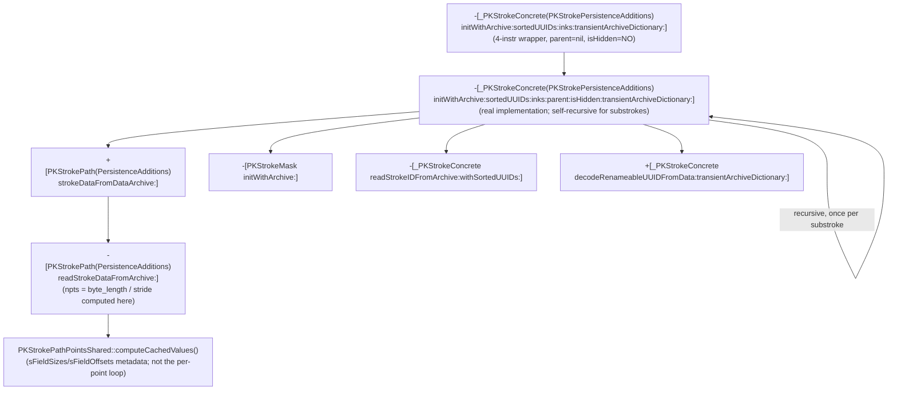

# From per-stroke archive to the stride-decode site

Continuation of `point-fields.md`. That file left `-[_PKStrokeConcrete
(PKStrokePersistenceAdditions) initWithArchive:sortedUUIDs:inks:
transientArchiveDictionary:]` (node K in its call graph) as the top-priority
undisassembled target, being the per-stroke constructor Function 3
(`initWithArchive:loadNonInkingStrokes:error:`) calls once per stroke. This
file disassembles it and follows the concrete call edges it reveals, all the
way down to the actual site that divides a raw byte length by a per-point
stride - the original motivating mystery.

## 1. `initWithArchive:sortedUUIDs:inks:transientArchiveDictionary:` is a thin wrapper

Disassembled via `ipsw macho disass PencilKit -s '-[_PKStrokeConcrete
(PKStrokePersistenceAdditions) initWithArchive:sortedUUIDs:inks:
transientArchiveDictionary:]' --demangle --force`. It is four instructions:
shuffle the incoming `transientArchiveDictionary` argument into position,
zero out two new argument slots, and tail-branch (`b`, not `bl`) into a
longer, distinctly-named selector on the same class:
`-[_PKStrokeConcrete(PKStrokePersistenceAdditions) initWithArchive:
sortedUUIDs:inks:parent:isHidden:transientArchiveDictionary:]`, passing
`parent:` as `nil` and `isHidden:` as `NO`. All the real work - and
everything below - lives in that six-argument selector, confirmed via `nm -U
PencilKit | grep initWithArchive:sortedUUIDs:inks:parent`.

## 2. `initWithArchive:sortedUUIDs:inks:parent:isHidden:transientArchiveDictionary:`

Same binary/toolchain. This function is substantial (~230 instructions plus
ARC exception-landing-pad cleanup blocks) and is **self-recursive** - it
calls itself, by the same six-argument selector, once per "substroke" (see
§2d). Argument registers on entry, and the callee-saved registers they're
moved into for the body: `self`→x26 (unused further; a fresh instance is
`init`'d separately), the per-stroke `archive` struct pointer→x24,
`sortedUUIDs`→x19, `inks`→x20, `parent`→x21 (also spilled to `[sp]`),
`isHidden`→x25, `transientArchiveDictionary`→x22.

### 2a. Entry bounds check

If `archive+0xb0` is non-null, a 32-bit field at `(archive+0xb0)+0x10` is
read as an index and bounds-checked (`b.ls`) against `[sortedUUIDs count]`;
if the index exceeds the count, the function abandons construction
immediately and returns `nil` (same defensive shape `point-fields.md`
described for other archive-index reads). If `archive+0xb0` is null, this
check is skipped entirely.

### 2b. Fields read from `archive` and what they become

A fresh instance is obtained via a plain `[self init]` and used as the
receiver (x23) for the rest of the function, then populated field-by-field.
All offsets below are on this function's own `archive` argument - a
different struct from Function 3's outer per-drawing `archive` (same
begin/end-pointer-pair idiom family, but distinct layout, since these are
per-stroke fields):

- `+0x78`: stroke's own identity UUID. If non-null, an 8-byte pointer to raw
  UUID bytes is read from it and passed to `initWithUUIDBytes:`; if null, a
  fresh UUID is generated (bare `UUID` message send to an unnamed global
  class reference, same unconfirmed-identity pattern noted elsewhere in this
  directory). Result stored via `_setStrokeUUID:`.
- `+0x68`: if non-null, passed together with `sortedUUIDs` to
  `-[_PKStrokeConcrete readStrokeIDFromArchive:withSortedUUIDs:]` (confirmed
  exact selector via `nm`), whose result (a 24-byte value written across two
  stack slots, consistent with a UUID+generation-number pair) is handed to
  `set_sortID:`.
- `+0xb0`: same `readStrokeIDFromArchive:withSortedUUIDs:` call again, result
  passed to `set_version:` instead. (This is the same field already consulted
  for the §2a bounds check, reused here as an actual archive-with-sortedUUIDs
  lookup, not just a bounds probe.)
- `+0xb8`, bit `0x2`: if set, a value at `archive+0x60` is read and passed to
  `_setShapeType:`.
- `+0x28`: if non-null, its first field is passed (along with
  `transientArchiveDictionary`) to `+[_PKStrokeConcrete
  decodeRenameableUUIDFromData:transientArchiveDictionary:]` (a *class*
  method - confirmed by the `_OBJC_CLASS_$__PKStrokeConcrete` receiver load
  immediately before the call), and the result stored via `_setGroupID:`. If
  null, no group ID is set at all (no default-generation fallback, unlike
  most other optional fields here).
- `+0x58`: identical `decodeRenameableUUIDFromData:transientArchiveDictionary:`
  pattern, feeding `_setRenderGroupID:` instead.
- `+0x30` (an "ink index"), gated by bit `0x1` of a flag byte at `+0xb8`:
  bounds-checked against `INT64_MAX` (sentinel "absent") and against
  `[inks count]`; on either failure, an `os_log` diagnostic is emitted
  (subsystem `"com.apple.pencilkit"`, format string `"Archive had invalid ink
  index: %lu"`, read directly as a literal `cstring` operand) and the index
  is treated as invalid rather than aborting construction. When valid, `inks[
  index]` is fetched via `objectAtIndexedSubscript:` and stored via
  `_setInk:`. When invalid *and* `parent` (the recursion argument, see §2d)
  is non-null, the parent stroke's own `ink` (via plain `ink` accessor) is
  used as a fallback instead, with a second `os_log` message ("Unable to find
  ink from saved inkIndex or parent") emitted only if `parent` is *also* nil.
  This is the first concrete evidence in this directory of ink being
  inherited from a parent stroke.
- `+0x20`: if non-null, a `drawing::Rectangle` C++ object is copy-constructed
  from it (`bl drawing::Rectangle::Rectangle(drawing::Rectangle const&)` -
  confirmed C++ symbol, the same `drawing` namespace `envelope.md` describes
  as the real protobuf parse target) and its four `float32`s widened to
  `double` and passed to `_setBounds:`. **This settles a `point-fields.md`
  "Not concluded" item**: real (non-placeholder) per-stroke bounds, at this
  level of the archive tree, come directly from a live `drawing::Rectangle`
  object reachable from the archive - i.e. this per-stroke `archive` struct
  is not purely a flat C struct the way Function 3's was; at least this one
  field is a genuine pointer into the parsed protobuf `drawing::*` object
  tree. If `+0x20` is null, a fixed global default-transform-shaped constant
  is used instead via `_setTransform:` (see next item) rather than a
  separate bounds default - `_setBounds:` is simply not called in that case.
- Transform (`_setTransform:`): a fixed global 6-double constant (presumably
  an identity affine transform) is always set first. Then, if `archive+0xa8`
  is non-null, two `float32` pairs are read from it (widened to `double`,
  NaN-checked per-component via the same `fcmeq`/`bsl` select idiom
  `point-fields.md`'s Function 2 used for color) and `_setTransform:` is
  called again with the real values where valid, default-constant components
  elsewhere. If `archive+0xa8` is null, `parent`'s own `_transform` is copied
  instead (if `parent` is non-nil) - another parent-inheritance fallback.
- Ink transform (`_setInkTransform:`): same NaN-select pattern, reading from
  `archive+0x38`, but only set at all if `archive+0x38` is non-null - no
  parent-fallback branch for this one.
- `+0x80`: raw value copied directly to `_setFlags:`.
- `+0x70`: if non-null, passed to `+[PKStrokePath(PersistenceAdditions)
  strokeDataFromDataArchive:]` and the result stored via `set_strokeData:`
  (see §3 - this is the edge into the actual point-decoding chain). If null,
  `parent`'s own `_strokeData` is copied instead if `parent` is non-nil;
  if both are absent, `strokeData` is left unset.

### 2c. `+0xc0`/`+0xc8`: `unknownFields`, same `shared_ptr` idiom as Function 3

If `archive+0xc0` is non-null, a `std::shared_ptr`-shaped two-word value
(pointer + control block, with an explicit atomic `ldadd` refcount increment
on the control block at `archive+0xc8`) is moved into the new stroke's
`_unknownFields` ivar (located via `OBJC_IVAR_$__PKStrokeConcrete
._unknownFields`, an exact ivar-offset symbol), releasing any previously
held control block via `std::__1::__shared_weak_count::__release_shared`.
Identical shape to Function 3's drawing-level `unknownFields` handling in
`point-fields.md`, just at a different archive offset (`+0xc0`/`+0xc8`
instead of `+0x80`/`+0x88`).

### 2d. Substrokes: this function recurses into itself

`archive+0x88`/`+0x90` is a begin/end pointer-pair array (element count =
byte-length `>> 3`, i.e. 8-byte pointer-sized entries - same idiom as every
other array in this directory). If non-empty:

- `archive+0xa0`, if non-null, feeds `readStrokeIDFromArchive:
  withSortedUUIDs:` into `set_substrokesVersion:`.
- An `NSMutableArray` is allocated with capacity equal to the element count
  and stored via `set_substrokes:`.
- For each element (a per-substroke archive-entry pointer), the function
  inspects a nested pointer-pair at that entry's own `+0x40` offset (empty or
  not) purely to decide the `isHidden:` argument for the recursive call: if
  that nested pair is non-empty, `isHidden` is taken from bit 0 of the outer
  function's own `isHidden` parameter (threaded straight through); if empty,
  `isHidden` is instead taken from bit 0 of the *just-built parent stroke's
  own* `_flags` value. Either way, the function then calls **itself** -
  `-[_PKStrokeConcrete(PKStrokePersistenceAdditions) initWithArchive:
  sortedUUIDs:inks:parent:isHidden:transientArchiveDictionary:]` - passing
  the substroke's archive-entry pointer as `archive:`, the *same*
  `sortedUUIDs`/`inks`/`transientArchiveDictionary` values threaded down
  unchanged, and the just-built stroke (x23, the enclosing call's own result)
  as `parent:`. The returned child stroke, if non-nil, is appended to the
  parent's `substrokes` array via `addObject:`.

This confirms strokes form a recursive tree (substrokes), built by repeated
self-invocation of this one function, with ink/transform/hidden-state
inheritance from parent to child wherever the child's own archive fields are
absent (§2b/§2d above) - a new structural fact not previously documented in
this directory.

### 2e. Stroke mask and mutation guard

`archive+0x40`/`+0x48` (another begin/end pointer pair): if non-empty, a
fresh `_OBJC_CLASS_$_PKStrokeMask` instance is built via `-[PKStrokeMask
initWithArchive:]`, passing the *entire* outer `archive` struct pointer
(not a sub-field) as its own `archive:` argument, and attached via
`_setStrokeMask:`. Not disassembled further.

As in Function 3, a global mutation-counter value is snapshotted at function
entry and re-checked at the normal return point; on mismatch, an
error/cleanup path runs instead of returning the built stroke - same
unconfirmed-purpose guard noted in `point-fields.md`.

## 3. `+[PKStrokePath(PersistenceAdditions) strokeDataFromDataArchive:]`

Three-instruction-plus-boilerplate wrapper: allocs a `PKStrokePath` and
tail-calls `-[PKStrokePath(PersistenceAdditions) readStrokeDataFromArchive:]`
on it with the same archive-field pointer. Confirmed via `nm -U PencilKit |
grep strokeDataFromDataArchive`.

## 4. `-[PKStrokePath(PersistenceAdditions) readStrokeDataFromArchive:]` - the stride-division site

This is the function the whole `point-fields.md` investigation was ultimately
looking for. Its `archive` argument (x20/x2) is a *third*, distinct small
struct (not the per-stroke struct from §2, not Function 3's per-drawing
struct) - call it the "points archive." Offsets below are on it.

- Allocates a fresh, zero-initialized `0x70`-byte block via a
  `malloc_type`-tagged allocator call, wraps it in a `std::shared_ptr<
  PKStrokePathPointsShared>` (confirmed exact C++ type name from the
  demangled `std::__1::shared_ptr<PKStrokePathPointsShared>` constructor
  symbol), and stores that shared_ptr into the `PKStrokePath` instance at
  `self+0x8` (releasing whatever shared_ptr was previously there). The rest
  of this function populates fields of that freshly-allocated
  `PKStrokePathPointsShared` struct (referred to as `shared` below, its raw
  pointer kept in a register across the function) directly.
- `points_archive+0x54` is a one-byte flag field, tested repeatedly via `tst`
  against several bit masks (`0x2`, `0x8`, `0x10`, `0x20`, `0x40`) to gate
  presence of the fields below - same "presence bitmask" idiom used
  throughout this directory, but a fresh, function-local bitmask distinct
  from anything in §2.
  - bit `0x20` gates `points_archive+0x48` (a `double`, else `0.0`) → stored
    to `shared+0x0`.
  - bit `0x40` gates a byte at `points_archive+0x50` (else a hardcoded `1`) →
    stored, narrowed to one bit, to `self+0x60` (a field on the
    `PKStrokePath` object itself, not `shared`).
  - bit `0x8` gates `points_archive+0x30` (a pointer, else `NULL`) → stored to
    `shared+0x20`.
  - bit `0x2`, combined with `points_archive+0x18` being non-null: reads an
    8-byte pointer-and-length pair (`{ptr, len}`) from `*(points_archive
    +0x18)` and appends `len` bytes from `ptr` into a `std::vector<unsigned
    char>` embedded in `shared` at offset `+0x8` (confirmed from the call to
    `std::__1::vector<unsigned char, ...>::__append(unsigned long)`
    immediately followed by a raw copy). `points_archive+0x10` is also
    stashed into `shared+0x28` alongside this.
- **The stride division itself**: if `points_archive+0x20` (a scalar - the
  per-point byte stride) and `points_archive+0x28` (a pointer) are both
  non-null, the function reads an 8-byte length field from
  `*(points_archive+0x28)+0x8`, computes `length / stride` via `udiv`, and
  stores the quotient into `shared+0x30`. This is the exact `npts = byte_length
  / stride` computation `point-fields.md`'s `.proto` comment describes as
  "implicit, not itself a wire-format construct" - now located precisely.
  **Correction from §7**: `shared+0x30` is read back out via the identical
  `udiv` idiom by `PKStrokePathPointsPrivate::count()`, dividing the same
  begin/end byte range by `shared+0x30` again - i.e. `shared+0x30` is stored
  and consumed as **the per-point-varying-channel byte stride**, not a
  precomputed point count as this paragraph originally concluded (the two
  are trivially confusable, since both this function and `count()` compute
  `length / shared+0x30` and only differ in which of the two results -
  quotient vs. divisor - each one keeps).
  Separately (same `points_archive+0x28` object), its own `{ptr, len}` pair
  is copied verbatim into a *second*, independent `std::vector<unsigned
  char>`, this one embedded directly on the `PKStrokePath` object itself at
  `self+0x18` (not on `shared`) - i.e. the raw point bytes end up stored in
  two different places for two different purposes.
- `points_archive+0x40`: stroke-path identity UUID, same
  present-bytes-vs-fresh-`UUID` pattern as everywhere else in this
  directory, stored to `self+0x68`.
- Calls `PKStrokePathPointsShared::computeCachedValues()` (confirmed C++
  instance method, non-inlined `bl`) on `shared` - see §5.
- A handful of remaining fields (`points_archive+0x38`/`+0x54` bit `0x10` →
  `self+0x58`; `points_archive+0x8` or, if flag bit `0` is set instead, `self
  _pointsCount` → `self+0x50`; a second `shared_ptr`-shaped pair at
  `points_archive+0x58`/`+0x60` → `self+0x30`) round out the object but were
  not chased further - out of scope for the stride question.
- `self+0x48` is unconditionally set to the sentinel `0x7fefffffffffffff`
  (just under `DBL_MAX`) at the end - plausibly a "cached bounds not yet
  computed" dirty marker, consistent with `point-fields.md`'s open question
  about where lazily-computed stroke bounds come from, though this pass
  cannot confirm what later reads/clears this sentinel.

## 5. `PKStrokePathPointsShared::computeCachedValues()` - per-field size/offset tables, but not the per-point loop

Confirmed C++ symbol (`__ZN24PKStrokePathPointsShared19computeCachedValuesEv`,
demangled directly by `ipsw`), called on `self=shared` from §4. This function
references two data-section tables by name, both resolved directly from
`adrp`/`add` operands (not inferred): `(anonymous namespace)::sFieldSizes`
and `(anonymous namespace)::sFieldOffsets`. Both are indexed by an 11-entry
(`0xb`), 8-byte-stride array (`lsl #3` scaling), addressed by a per-point
"channel index" `0..10`.

- `shared+0x28` (set in §4 only when `points_archive+0x18` was present and
  its bit `0x2` was set) is read as an **11-bit presence bitmask** - one bit
  per optional per-point channel.
- A first loop walks bits `0..10` of that mask; for each set bit `i`, it
  copies `sFieldSizes[i]` bytes from a running cursor into a channel's slot
  at `sFieldOffsets[i]` within a 32-byte on-stack scratch record, advancing
  the read cursor by `sFieldSizes[i]` each time. The read cursor starts at
  the raw-bytes vector built in §4 (`self+0x8`'s vector `begin()`), so this
  is directly consuming the flat per-point tail bytes - but it runs **once**,
  not once per point: the result (32 bytes) is copied into `shared+0x38`/
  `+0x48` as a single fixed record, not multiplied by the point count from
  `shared+0x30`. This reads as building one reference/template record - e.g.
  default values, or a decode key - not decoding the whole points array.
- A second, structurally similar loop walks a *different* 11-bit mask
  (`shared+0x20`, set in §4 from `points_archive+0x30` when present) and
  builds a per-channel cumulative-offset table into an 11-byte array at
  `shared+0x5c`, with the running total (the byte size of a struct containing
  only this second mask's selected channels) stored to `shared+0x58`, and a
  bit-population-style count (same NEON idiom as the first mask) stored to
  `shared+0x68`.

**This confirms the mechanism behind the observed 12/14/16/18/20/22-byte
strides**: a per-path 11-bit channel-presence mask (`shared+0x28`, ultimately
from `points_archive+0x18`'s referenced struct) selects which of up to 11
optional auxiliary channels are packed after each point's X/Y pair, with
fixed per-channel byte widths (`sFieldSizes`) and fixed per-channel offsets
in an in-memory decoded-point record (`sFieldOffsets`) - the sum of the
selected channels' sizes is exactly the "stride minus 8" tail
`point-fields.md` measured empirically. **However, this function itself does
not loop over all `npts` points** - it computes shared per-channel metadata
once. The actual per-point walk that applies this metadata to every point in
the flat buffer (multiplying by `shared+0x30`'s count) is still not located -
see "Not concluded."

## 6. `sFieldSizes`/`sFieldOffsets` contents - found via their writer, not just their reader

An earlier revision of this file concluded the two tables' numeric contents
were unrecoverable from static analysis, since both addresses
(`0x1eb219438`/`0x1eb2193e0`) fall inside `PencilKit`'s `__DATA,__common`
section (a zerofill/BSS-class section with no on-disk file backing -
`otool -l` shows `offset 0` for it), and only *reader* call sites
(`computeCachedValues()`, `updateFromCachedValues()`) had been checked. **That
conclusion was wrong** - it never looked for the *writer*. `nm -U PencilKit`
shows a `dispatch_once`-token local symbol, `__ZZ32+[PKStrokePath
calculateOffsets]E9onceToken`, sitting at `0x1eb219388` - immediately
adjacent to `sFieldOffsets`/`sFieldSizes` in the same `__common` section
(all three fall within the same 176-byte common block). This is the writer's
entry point.

`+[PKStrokePath calculateOffsets]` (confirmed selector) is a plain
`dispatch_once_f` call site: it builds a stack-based ObjC block (pointer-auth
signed, as usual on arm64e) and calls `dispatch_once_f` against that
once-token, guaranteeing the block runs exactly once per process lifetime.
The block, `___32+[PKStrokePath calculateOffsets]_block_invoke` (confirmed
symbol), does nothing itself but load one captured value and tail-call
`+[PKStrokePath _calculateOffsets:sizes:]` (confirmed selector) with `x2` =
the address of `sFieldOffsets` and `x3` = the address of `sFieldSizes` -
i.e. this method's two out-parameters *are* the two `__common` tables,
passed by address.

`+[PKStrokePath _calculateOffsets:sizes:]`'s body writes to both output
addresses using nothing but `ldr q`/`stp q`/plain-immediate `mov`+`str`
instructions - nine total memory writes, all either copying a 16-byte
literal pair straight from a fixed, file-backed address range
(`0x1ae769170`-`0x1ae7691e0`, inside `PencilKit`'s `__TEXT` segment, i.e.
ordinary compiled-in constant data, not computed) or storing a bare
immediate (`#0x20`, `#0x2`) directly. There is no arithmetic, no branch, no
external call anywhere in this function - it is a pure, unconditional
literal-constant store, run once via `dispatch_once`. Because the source
literals live in `__TEXT` (file-backed, unlike the `__common` destination),
they were extracted with `dd` at the corresponding file offset (`__TEXT`
segment `fileoff` is `0` and `vmaddr` is `0x1ae60f000` for this binary, so
file offset = virtual address − `0x1ae60f000`), the same technique
`legacy_drawing.md` used for a jump table - the earlier conclusion that this
data "requires a live memory read" only held for the `__common` destination
addresses, not for the `__TEXT` source literals the writer copies from.

Decoded as eleven consecutive 8-byte little-endian integers each (matching
the `sFieldSizes[11]`/`sFieldOffsets[11]` indexing `computeCachedValues()`
and `updateFromCachedValues()` use), indexed by the same 0-10 channel/bit
index as everywhere else in this file:

| channel index (bit in the 11-bit presence mask) | `sFieldOffsets[i]` | `sFieldSizes[i]` |
|----|----|---|
|  0 |  0 | 8 |
|  1 |  8 | 4 |
|  2 | 12 | 4 |
|  3 | 16 | 2 |
|  4 | 18 | 2 |
|  5 | 20 | 2 |
|  6 | 22 | 2 |
|  7 | 24 | 2 |
|  8 | 26 | 2 |
|  9 | 28 | 4 |
| 10 | 32 | 2 |

Internally self-consistent: `sFieldOffsets[i]` is exactly the running sum of
`sFieldSizes[0..i-1]` (e.g. offset `12` at index 2 = size `8` + size `4` from
indices 0-1) - i.e. this is a real packed-record layout table, offsets are
derived from sizes in ascending bit-index order, not independently chosen.
If every one of the 11 channels were simultaneously present, the full
packed tail would be `32 + 2 = 34` bytes (offset of the last field plus its
own size), for a total per-point record of `8 (X/Y) + 34 = 42` bytes -
larger than any stride `point-fields.md` observed empirically (max `22`
bytes total, i.e. max `14` bytes of tail). This is not a contradiction: the
observed samples simply never had all 11 channels enabled simultaneously in
one path's presence mask - a tail of `14` bytes is reachable from several
different subsets of `{8,4,4,2,2,2,2,2,2,4,2}` (e.g. six of the `2`-byte
channels, or one `4` plus five `2`s, etc.), and this pass has no way to
determine, from the size table alone, exactly which subset any given sample
used - that still requires reading each sample's own presence-mask byte
(`points_archive+0x18`'s referenced struct in §4), which was not attempted
this pass. **What this table conclusively establishes** is the *number* of
optional channels (11, not some other count), their *individual byte
widths* (`8,4,4,2,2,2,2,2,2,4,2`, in this fixed bit-index order), and that
they are packed contiguously with no padding - a materially stronger result
than "the tail is 4-14 bytes of something," even without yet knowing which
channel bit corresponds to which semantic name (force/azimuth/altitude/
timestamp/etc.) or which bits were set in any specific observed sample.

No named symbol, string constant, or enum-like identifier tying these 11
indices to semantic field names was found searching from `PKStrokePathPointsShared`'s
own side (a targeted `nm`/`strings` grep for "azimuth"/"force"/etc. from this
class surfaced only unrelated PKInk/PKToolConfiguration azimuth-related API).
**§7 below finds the mapping anyway, from the other direction** - via
`PKStrokePoint`'s own named public/private accessors and the C++ class
`PKStrokePathPointsPrivate` they call into, whose per-channel methods are
individually named (`forceAtIndex`, `azimuthAtIndex`, etc.) and read from
these exact offsets/sizes.

## 7. Semantic identity of all 11 channels, confirmed via `PKStrokePathPointsPrivate`

§6 closed the "what are the numeric sizes/offsets" question but left every
channel's *name* unconfirmed. This section closes that too, via a route
distinct from `PKStrokePathPointsShared`: the public class `PKStrokePoint`
(confirmed real, `_OBJC_CLASS_$_PKStrokePoint`, with exactly the
hypothesized public properties - `location`, `timeOffset`, `size`,
`opacity`, `force`, `azimuth`, `altitude` - plus two undocumented ones,
`secondaryScale` and `threshold`, and two private ones, `_edgeWidth` and
`_radius2`, all confirmed via `nm -U PencilKit | grep -E '\-\[PKStrokePoint '`).
Disassembling these accessors shows most of them (`location`, `opacity`,
`force`, `threshold`, `_edgeWidth`) are 3-instruction wrappers that
tail-call into a **different** C++ class than `PKStrokePathPointsShared`:
`PKStrokePathPointsPrivate` (confirmed type name, from its own mangled
symbols, e.g. `__ZNK25PKStrokePathPointsPrivate15locationAtIndexEm`).
`azimuth`/`altitude` call the equivalent `*AtIndex` method and then apply a
small fixed bias (`fadd`/`fsub` against a literal constant) before
returning; `timeOffset`, `size`, and `secondaryScale` inline the equivalent
logic directly into `PKStrokePoint` rather than calling out, but read from
the exact same offsets `PKStrokePathPointsPrivate`'s own methods use.

`PKStrokePathPointsPrivate` has one C++ member relevant here: a pointer at
its own offset `+0x0` to a second, shared object - offsets read through that
pointer (`+0x20`, `+0x28`, `+0x30`, `+0x38` onward, `+0x5c`-`+0x66`) line up
exactly with `PKStrokePathPointsShared`'s layout as described in §4-§5 of
this file, strongly suggesting `PKStrokePathPointsPrivate` is a lightweight
per-range "view" object (consistent with its own `slice(_NSRange,
PKStrokePathPointsPrivate&) const` method and `-[PKStrokePoint
initWithSlice:index:]`) whose own `+0x10`/`+0x18` begin/end pointers are a
sub-range into the shared byte data, wrapping a `PKStrokePathPointsShared`
instance rather than being one - not proven identical, but the offset
agreement below is exact enough that this pass treats them as the same
underlying storage.

Every `PKStrokePathPointsPrivate::<channel>AtIndex(unsigned long) const`
method (eleven of them: `locationAtIndex`, `timestampAtIndex`,
`radiusAtIndex`, `aspectRatioAtIndex`, `edgeWidthAtIndex`, `forceAtIndex`,
`azimuthAtIndex`, `altitudeAtIndex`, `opacityAtIndex`, `radius2AtIndex`,
`thresholdAtIndex` - confirmed exact C++ symbol names) follows the identical
shape: test one bit of a presence-bitfield read through the shared pointer,
and branch between two addressing modes:

- **Bit clear (or requested point index out of range)**: read the channel's
  value from a fixed offset in a single shared "default" record (base
  `shared+0x38`) - exactly the 32-byte template `computeCachedValues()`
  builds in §5, at exactly `sFieldOffsets[i]` past that base, for every
  channel `i`.
- **Bit set**: compute `address = raw_points_bytes_begin + index *
  per_point_stride + shared[0x5c + i]` (an `madd` instruction fusing the
  multiply-by-stride and add-of-per-channel-offset in one op) and read from
  there - `shared[0x5c+i]` is exactly the per-channel cumulative-offset byte
  `computeCachedValues()`'s second loop (§5) writes for channel `i`. This
  directly answers this file's previous "where's the per-point loop"
  question (see below): **there is no bulk per-point decode loop** - each
  channel accessor computes one point's one field's address on demand, using
  metadata `computeCachedValues()` precomputed once per path. `count()`
  (confirmed method, used for bounds-checking in every accessor) computes
  `(end - begin) / stride` from the same begin/end pair `readStrokeDataFromArchive:`
  (§4) populated - stride here is read from the shared object's `+0x30`
  field, which this pass now reads as "the per-point-varying-channels
  stride," not the point count as an earlier revision of §4 guessed (a
  stride and a count are computed by the identical `udiv` idiom in this
  binary, and are easy to conflate without a second confirming site like
  this one).

The channel-index-to-size/offset match against §6's table is exact for all
eleven entries, and each accessor's own read width (`ldr s0` for `float32`,
`ldr h0` for a 16-bit half-float, or a plain `ldr`/`ldp` for the 8-byte
`location` pair) matches `sFieldSizes[i]` exactly:

| index | `sFieldOffsets`/`sFieldSizes` | channel (from `PKStrokePathPointsPrivate`) | raw storage | normalization applied by the accessor |
|---|---|---|---|---|
| 0 | 0 / 8  | `location` (→ `PKStrokePoint.location`) | two `float32` (x, y) | none |
| 1 | 8 / 4  | `timestamp` (→ `PKStrokePoint.timeOffset`) | `float32` | none |
| 2 | 12 / 4 | `radius` (→ `PKStrokePoint.size.width`, and combined with aspectRatio for `.height`) | `float32` | none |
| 3 | 16 / 2 | `aspectRatio` (→ `PKStrokePoint.size.height` via `radius * aspectRatio`) | `float16` | divided by a fixed constant |
| 4 | 18 / 2 | `edgeWidth` (→ `PKStrokePoint._edgeWidth`, private) | `float16` | divided by literal `10.0` |
| 5 | 20 / 2 | `force` (→ `PKStrokePoint.force`) | `float16` | divided by a fixed constant |
| 6 | 22 / 2 | `azimuth` (→ `PKStrokePoint.azimuth`) | `float16` | divided by a fixed constant, then biased by addition in the public accessor |
| 7 | 24 / 2 | `altitude` (→ `PKStrokePoint.altitude`) | `float16` | divided by a fixed constant, then `bias - raw` in the public accessor |
| 8 | 26 / 2 | `opacity` (→ `PKStrokePoint.opacity`) | `float16` | divided by a fixed constant |
| 9 | 28 / 4 | `radius2` (→ `PKStrokePoint._radius2`, private) | `float32` | none |
| 10 | 32 / 2 | `threshold` (→ `PKStrokePoint.threshold`, undocumented public) | `float16` | divided by a fixed constant (same slot as `opacity`'s) |

The normalization constants themselves live at fixed, named-adjacent
`adrp`/`ldr` addresses in `PencilKit`'s `__TEXT` segment (file-backed, same
as §6's literal-constant source range). **§8 below extracts the three that
matter most (`force`, `azimuth`, `altitude`) using exactly this
`dd`-against-file-offset technique**, and also corrects this table's "raw
storage" column for those three: it says `float16` above, but that is
wrong - see §8's opening paragraph.

This also resolves the presence-bitfield question §5/§6 left open. Two
distinct, now-named accessors exist on `PKStrokePathPointsPrivate`:
`pointFlags()` (reads the shared object's `+0x20` field) and
`constantFlags()` (reads `+0x28`) - both return a plain integer, not a
pointer, correcting an earlier guess in §4 that `shared+0x20` held "a
pointer." Cross-referencing against each `*AtIndex` accessor's own bit
tests: **`pointFlags` (`shared+0x20`) is the per-point-varying-channel
mask** - the one whose bits gate the `index`-addressed branch above and
whose cumulative layout `computeCachedValues()`'s second loop builds into
`shared+0x5c`/`+0x58` - while **`constantFlags` (`shared+0x28`) is the
whole-path-constant-channel mask** - the one `computeCachedValues()`'s
*first* loop (§5) uses to fill the single shared default record at
`shared+0x38`. In other words: a channel that is constant for an entire
stroke path (its `constantFlags` bit set) is stored once, read out of the
raw bytes only at path-load time into the shared default record, and never
takes up per-point space at all; a channel that varies per point
(`pointFlags` bit set) is the one actually packed into the flat, per-point,
variable-stride byte array `point-fields.md` originally set out to decode -
this is a materially more precise model than "the tail is 4-14 bytes of
enabled channels" and explains variability beyond simple presence/absence:
a channel can be present for a stroke yet cost zero per-point bytes if it's
constant across that stroke.

## 8. `force`/`azimuth`/`altitude` normalization constants - confirmed exact, and a correction to the table above

Session date 2026-09-12, live SSH access to the same Mac (`cooper.plug.rapidcow.net`,
macOS 26.6.2 build 25G83) this directory's other files were produced on,
reusing the `~/re-notes/PencilKit` extraction and `PencilKit.a2s` symbol
cache already sitting on that machine from the 2026-09-11 session - no
re-extraction needed, `ipsw dyld extract` wasn't even invoked this pass.

**Correction to §7's table**: the "raw storage" column calls channels 3-8/10
`float16`. That's wrong, at least for `force`/`azimuth`/`altitude` (index
5/6/7), and by strong analogy (identical accessor codegen shape, same
2-byte size bucket) very likely wrong for `aspectRatio`/`edgeWidth`/
`opacity`/`threshold` too (indices 3/4/8/10 - not individually disassembled
this pass, so left as an inference, not a confirmed fact, for those four).
The tell is in the disassembly of each `*AtIndex` accessor
(`__ZNK25PKStrokePathPointsPrivate12forceAtIndexEm` at `0x1ae682950`,
`...14azimuthAtIndexEm` at `0x1ae681838`, `...15altitudeAtIndexEm` at
`0x1ae682a68` - all found via `nm -U ~/re-notes/PencilKit | grep -i AtIndex`,
disassembled via `ipsw macho disass ~/re-notes/PencilKit -s '<mangled-name>'
--demangle --force`; e.g. `azimuthAtIndex`'s mangling breaks down as
`_Z` [mangled-name marker] `N` [nested-name open] `K` [const method]
`25PKStrokePathPointsPrivate` [25-char class name] `14azimuthAtIndex`
[14-char method name] `E` [nested-name close] `m` [one `unsigned long`
param] - the leading digit before each identifier is just that
identifier's `strlen`, a quick way to sanity-check a mangled name by hand):
each ends with

```
ldr  h0, [x8]        ; load the raw 2 bytes into a v-register (no type implied yet)
ucvtf d0, d0         ; UNSIGNED-INT-to-float convert
adrp x8, 0x1ae769000
ldr  d1, [x8, #0x14X]
fdiv d0, d0, d1
ret
```

`ucvtf` converts an integer value to floating-point; a genuine `float16`
reinterpretation would need `fcvt` (float-to-float). So the raw 2 bytes are
a **plain fixed-point `uint16`**, not IEEE754 half-precision - confirmed
both by this instruction choice and empirically (interpreting a real
sample's `force` bytes as `float16` gives nonsense values ~0.00002;
as `uint16` they give a sane 0-to-1-ish pressure curve, see below).

`azimuth`/`altitude` additionally go through a second, public-API wrapper
that isn't in `PKStrokePathPointsPrivate` at all: `-[PKStrokePoint azimuth]`
(`0x1ae645e9c`) and `-[PKStrokePoint altitude]` (`0x1ae645ec8`), found via
`nm -U ~/re-notes/PencilKit | grep -E '\-\[PKStrokePoint (azimuth|altitude)\]'`.
Each calls straight into its `*AtIndex` private accessor, then applies one
more constant: `azimuth` does `fadd d0, d0, d1` (add a bias), `altitude`
does `fsub d0, d1, d0` (bias **minus** raw, not raw minus bias - order
matters, since it means `altitude` decreases as the raw accessor's
pre-bias value increases).

Every constant was resolved from its `adrp base + ldr #imm` pair to an
absolute address, converted to a `__TEXT` file offset via
`file_offset = vmaddr - 0x1ae60f000` (`__TEXT`'s `vmaddr`/`fileoff` from
`otool -l ~/re-notes/PencilKit`, `fileoff` is `0`, same segment §6 used),
then read with `dd if=~/re-notes/PencilKit bs=1 skip=$((file_offset))
count=8` and unpacked as a little-endian IEEE754 `double` - identical
mechanical technique to §6's `sFieldSizes`/`sFieldOffsets` extraction, just
pointed at four new addresses (two divisors, two biases) instead of one
16-literal table.

| channel | divisor addr | divisor value | bias addr | bias value | formula |
|---|---|---|---|---|---|
| `force` | `0x1ae769140` | `1000.0` (exact) | none | - | `raw_uint16 / 1000.0` |
| `azimuth` | `0x1ae769138` | `65535/(2π)` (exact) | `0x1ae768848` | `-π` (exact) | `raw_uint16 × (2π/65535) - π` |
| `altitude` | `0x1ae769150` | `4×65535/(2π)` (exact, i.e. `65535/divisor = π/2` exactly) | `0x1ae768850` | `π/2` (exact) | `π/2 - raw_uint16 × (π/2/65535)` = `(π/2)×(65535-raw)/65535` |

All three divisor/bias values are exact IEEE754 doubles (not approximations
landing near a clean number by coincidence) - `1000.0` outright, and the
azimuth/altitude constants built directly from `65535` and `π`
(`65535/altitude_divisor` comes back as exactly `1.5707963267948966`, i.e.
`math.pi/2` to full double precision). That, plus the empirical cross-check
below, is why this pass treats all three as confirmed rather than merely
plausible.

**Empirical cross-check**, against a real stroke decoded straight from the
user's own archived `NoteStore.sqlite` (`tools/apple-notes-drawing-decode.pl
--pk 15436`, point-flags subset `{altitude, force, radius, timestamp}` -
`azimuth` wasn't present in this particular stroke's channel mask, so only
`force`/`altitude` could be checked against real bytes this pass):
- `force` raw `uint16` sequence for this stroke: `344, 428, 484, 502, 510,
  502, 480, 420, 332, 237, 147, 66, 0` -> `/1000.0` gives `0.344 -> 0.510
  (peak, mid-stroke) -> 0.0` (at the final point, i.e. pen lift) - exactly
  the press-then-lift pressure curve a real handwriting stroke should
  produce.
- `altitude` raw `uint16` goes `30976` (first three points, unchanged) down
  to `28768` (last point) -> formula gives `≈ 47.5°` at the start
  drifting to `≈ 50.5°` at the end - a small, physically
  plausible wobble in pencil-to-surface angle over one stroke, not noise.
- `timestamp` (already known to need no normalization, per §7's table) was
  also checked against this same stroke as a sanity anchor: successive
  deltas are a steady `~4-8ms`, consistent with Apple Pencil's up-to-240Hz
  sample rate - confirms the `float32`-seconds-no-scaling reading already
  in the table is still correct.

## 9. `aspectRatio`/`edgeWidth`/`opacity`/`threshold` - the remaining four channels, and an unrelated ink-identifier finding

Same session as §8 (2026-09-12, same SSH access, same `~/re-notes/PencilKit`
extraction). Disassembled all four remaining `*AtIndex` accessors
(`__ZNK25PKStrokePathPointsPrivate18aspectRatioAtIndexEm` at `0x1ae6827d8`,
`...16edgeWidthAtIndexEm` at `0x1ae682898`, `...14opacityAtIndexEm` at
`0x1ae682b28`, `...16thresholdAtIndexEm` at `0x1ae682be8`) the same way as
§8: `nm -U ~/re-notes/PencilKit | grep -i AtIndex` for the mangled symbol,
`ipsw macho disass ~/re-notes/PencilKit -s '<mangled-name>' --demangle
--force` to disassemble it. All four show the identical `ldr h0, [x]` /
`ucvtf d0, d0` / `fdiv` shape as `force`/`azimuth`/`altitude` - confirming
§8's "presumed `uint16` by analogy" guess was correct for all four, not
just plausible. None of the four go through a `PKStrokePoint`-level public
wrapper adding a bias afterward (unlike `azimuth`/`altitude`) - each
`*AtIndex` accessor divides and returns directly, matching §7's original
note that `opacity`/`threshold`/`_edgeWidth` (and, now also confirmed,
`aspectRatio`) are plain wrappers with no extra bias step.

| channel | divisor | how found |
|---|---|---|
| `aspectRatio` | `1000.0` | reuses the *exact same* constant address as `force` (`0x1ae769140`) - a shared divisor across two unrelated channels |
| `edgeWidth` | `10.0` | not a data-table constant at all - a bare immediate operand, `fmov d1, #10.00000000`, visible directly in the instruction. This independently confirms §7's pre-existing "divided by literal `10.0`" note, which had predated any live disassembly of this specific accessor. |
| `opacity` | `32767.5` | new address `0x1ae769158`, `dd`'d out the same way as §8's constants; exactly `65535/2` |
| `threshold` | `32767.5` | same address as `opacity` - confirms §7's pre-existing "same slot as `opacity`'s" note |

All four: `decoded_value = raw_uint16 / divisor`, no bias. This closes out
every one of the 11 point channels from §6/§7's table - all now have a
confirmed decode formula (10 with a divisor-only formula, 2 of those 10
[`azimuth`/`altitude`] additionally biased in a `PKStrokePoint`-level
wrapper, `location`/`timestamp`/`radius`/`radius2` needing no division at
all).

### An ink-identifier mapping, found while looking for `ink_category` - important caveat attached

While chasing whether `StrokeSeqInfo.ink_category` (the `.proto` field
showing observed raw values `2`/`3`/`4`/`6` in real samples, printed as
`; guess: unknown` by the decoder for value `6`) has a confirmed meaning,
found and disassembled `+[PKInk(PKCommandCompatibility)
identifierForCommandType:wantsObjectErase:]` (`0x1ae755eb0`, found via `nm
-U ~/re-notes/PencilKit | grep -iE 'identifierForCommandType|PKInkIdentifier'`,
which also surfaced sixteen `_PKInkIdentifier*` string-constant symbols).
This function maps a raw `int32` "command type" argument to a named ink
identifier, confirmed directly from string literals visible as instruction
operands (`"com.apple.ink.pencil"`, `"...pen"`, `"...marker"`,
`"...eraser"`, `"...objectEraser"`, `"...lasso"`) plus the
`arrayWithObjects:count:`/`objectAtIndexedSubscript:` call sequence used to
index into them:

| commandType | ink identifier |
|---|---|
| 0 | `com.apple.ink.pencil` |
| 1 | `com.apple.ink.pen` |
| 2 | `com.apple.ink.marker` |
| 3 | `com.apple.ink.eraser`, or `com.apple.ink.objectEraser` if `wantsObjectErase` is true - handled by its own branch (`cmp w2, #0x3` / `b.ne`) *before* the array lookup below, not via the array itself |
| 4 | `com.apple.ink.lasso` |
| anything else (unsigned `> 4`) | logs `"Unknown command type for ink: %d"` (subsystem `"com.apple.pencilkit"`, same `os_log` idiom as `point-decode-pipeline.md`'s other diagnostics) and falls back to `com.apple.ink.pen` |

**Important caveat, not a confirmation of `ink_category`'s meaning**: this
function is only ever called from `-[_PKStrokeConcrete(
PKStrokePersistenceAdditions) initWithLegacyArchive:sortedUUIDs:]`
(`point-fields.md`'s Function 2, reading its `archive+0x60` field as the
`commandType` argument) - and that entire `initWithLegacyArchive:` subgraph
was already flagged in `point-fields.md`'s own "Not concluded" section as
**never confirmed reachable** from the real `com.apple.drawing.2` read
path; it may be dead code for modern data, same status as
`legacy_drawing.md`'s namespace. The path that *is* confirmed reachable
(`point-decode-pipeline.md`'s own `K`/`K2` chain, via
`initWithArchive:sortedUUIDs:inks:parent:isHidden:transientArchiveDictionary:`)
picks ink a completely different way: an `ink_index` read from `K2`'s own
`archive+0x30` (gated by flag bit `0x1` of `archive+0xb8`, per §2b above),
indexing straight into the drawing-level `inks[]` array - never through
`identifierForCommandType:wantsObjectErase:` at all. So this table is real
and confirmed **on its own terms**, but it does **not** establish what
`StrokeSeqInfo.ink_category` means on the confirmed-reachable path - that
would require tracing `K2`'s own `ink_index`/`archive+0x60` "shapeType"
fields back to specific `Stroke`/`StrokeSeqInfo` `.proto` field numbers,
which has not been attempted. Recorded here because the mapping itself is
genuine and may still be useful (e.g. if a future sample turns out to
route through the legacy path after all, or if `ink_category`'s own values
turn out to coincidentally line up with this table once traced) - but
treat any resemblance between `ink_category`'s observed `2`/`3`/`4`/`6` and
this table's `0`-`4` indices as coincidence until actually traced, not
evidence.

## Not concluded

- `edgeWidth`'s "divided by literal `10.0`" note is now independently
  confirmed by live disassembly (§9), not just inherited from an earlier
  pass. All 11 point channels now have confirmed decode formulas (§7-§9) -
  nothing left open in the per-point channel table itself.
- `StrokeSeqInfo.ink_category`'s actual meaning: **superseded, see
  `drawing.md`.** §9 (above) only got as far as ruling out one candidate
  explanation; a later same-day session went further and found real
  `drawing::Stroke` field names via `formatText()` string literals -
  there's no `seq`/`ink_category`/`StrokeSeqInfo`-shaped field anywhere in
  the real schema at all, so the question wasn't "what does `ink_category`
  mean" but "`ink_category` almost certainly isn't a real field, period."
  `apple-notes-drawing-2.proto` and `apple-notes-drawing-decode.pl` have
  since been updated accordingly: `StrokeSeqInfo` is now `StrokeUnknown2`
  with plain unlabeled `f1`/`f2`/`f3`, printed by the decoder as `(unknown2
  ...)` rather than asserted `seq`/`ink-category-raw` values. The real
  `inkIndex` field `drawing.md` did confirm (matching `K2`'s already-
  confirmed ink-selection mechanism by name) still hasn't been traced to a
  specific wire field number - that part of the original question is
  still open, now recorded in `drawing.md`'s own "Not concluded" instead of
  here.
- Whether `PKStrokePathPointsPrivate` is literally the same type as
  `PKStrokePathPointsShared` or a distinct "view" type wrapping/pointing at
  one - inferred from matching offsets (§7), not proven by a shared symbol
  or cast.
- `-[_PKStrokeConcrete readStrokeIDFromArchive:withSortedUUIDs:]` - called
  from three sites in §2b/§2d, confirmed exact selector, not itself
  disassembled; its 24-byte result shape (UUID-sized value across two stack
  slots) is inferred from the caller's stack layout only.
- `-[PKStrokeMask initWithArchive:]`, `+[_PKStrokeConcrete
  decodeRenameableUUIDFromData:transientArchiveDictionary:]` - confirmed call
  targets, not disassembled.
- Whether `points_archive` (§4's argument) is populated from the same parsed
  `drawing::Drawing` C++ tree §2b's `drawing::Rectangle` bounds field came
  from, i.e. whether it's a pointer straight into `Geometry.points`'s parsed
  protobuf representation or something already copied out - not traced back
  further than `-[_PKStrokeConcrete(...) initWithArchive:sortedUUIDs:inks:
  parent:isHidden:transientArchiveDictionary:]`'s own `archive+0x70` field
  (§2b), which is where `points_archive` (this function's `archive`
  argument) actually comes from.

## Provenance

Same source Mac/OS/build and toolchain as the other files in this directory
(macOS 26.6.2, build 25G83, Apple Silicon T8103; `ipsw` v3.1.714; `otool`
from Xcode Command Line Tools; `nm`). Used `otool -l` (segment/section
listing) to determine that `sFieldSizes`/`sFieldOffsets` live in a zerofill
`__DATA,__common` section with no on-disk file backing. §6's writer
(`+[PKStrokePath calculateOffsets]`) was located, after that dead end, by
`nm -U PencilKit | grep -iE 'field|once'` turning up a `dispatch_once`-token
local symbol (`__ZZ32+[PKStrokePath calculateOffsets]E9onceToken`) sharing
the same `__common` block as the two tables - a naming-adjacency technique
not used elsewhere in this directory. Also attempted `ipsw dyld xref`
(a `[WIP]`-flagged ipsw subcommand for cross-reference search directly
against the live dyld shared cache) and a brute-force whole-`__TEXT.__text`
disassembly-plus-grep of the extracted `PencilKit` binary as parallel,
more-exhaustive approaches to the same writer-search question; both were
technically successful (the whole-section disassembly completed and its
`adrp 0x1eb219000` hits were reviewed) but contributed no additional writer
sites beyond what the naming-adjacency approach already found - the
`dispatch_once`/`_calculateOffsets:sizes:` chain is the only writer for
these two tables in `PencilKit`. `dd` was used twice: once (per §5, as
before) attempting to read the `__common` destination addresses directly
(no file backing, zero bytes, as expected), and a second time, successfully,
against `__TEXT` segment file offset `0x15a170` (computed from
`vmaddr 0x1ae60f000`, `fileoff 0`) to read the sixteen file-backed 8-byte
literals `+[PKStrokePath _calculateOffsets:sizes:]` copies into the two
tables - the actual source of §6's decoded values. Method, class, C++
symbol, and constant identifiers referenced above (e.g.
`initWithArchive:sortedUUIDs:inks:parent:isHidden:transientArchiveDictionary:`,
`readStrokeIDFromArchive:withSortedUUIDs:`,
`decodeRenameableUUIDFromData:transientArchiveDictionary:`,
`drawing::Rectangle::Rectangle`, `OBJC_IVAR_$__PKStrokeConcrete
._unknownFields`, `strokeDataFromDataArchive:`, `readStrokeDataFromArchive:`,
`PKStrokePathPointsShared`, `computeCachedValues`, `updateFromCachedValues`,
`sFieldSizes`, `sFieldOffsets`, `calculateOffsets`, `_calculateOffsets:
sizes:`) are exact, verbatim symbol names from `PencilKit.framework`'s
symbol table/disassembly, extracted from the macOS 26.6.2 (25G83) arm64e
dyld shared cache in a prior session (not re-extracted here). The two
`os_log` literal strings ("Archive had invalid ink index: %lu", "Unable to
find ink from saved inkIndex or parent") are exact, verbatim string
constants read directly as instruction operands. The `sFieldSizes`/
`sFieldOffsets` table *values* in §6 are decoded integers derived from raw
bytes read via `dd`, reported as a decimal table rather than as raw
hex/binary content, consistent with this directory's no-raw-bytes
convention; no disassembly, hex dump, or extracted binary content is
otherwise reproduced here or committed to this repo.

§7 was produced in a later pass of the same session, starting from an
untested hypothesis (that the public `PKStrokePoint` class's documented
properties might correspond to the 10 optional channels) supplied as a
starting point, then independently confirmed rather than assumed: `nm -U
PencilKit | grep -i strokepoint` and `grep -E '\-\[PKStrokePoint '`
established the class and every accessor selector actually exist verbatim
in this binary (not just NotesEditor/NotesShared, which were also checked
per the same instruction and came back empty for `PKStrokePoint` itself);
each accessor was then disassembled individually (the demangled
`(unsigned long) const`-suffixed C++ signature form did not resolve as an
`ipsw -s` argument for the `PKStrokePathPointsPrivate::*AtIndex` methods,
so the mangled form from `nm`'s raw output was used instead, the same
fallback `legacy_drawing.md` needed for a similar reason). The
offset/size/bit-index agreement against `PKStrokePathPointsShared`'s
already-recovered `sFieldOffsets`/`sFieldSizes` (§5-§6) was checked by hand
across all eleven channels, not sampled.

## Call graph (this file's additions)

Confirmed call edges only, extending `point-fields.md`'s graph from node K.



`K` is the same node `K` in `point-fields.md`'s call graph. This file
resolves it fully and shows it bottoms out, for point data specifically, at
`computeCachedValues()` - which itself defers the real per-point stride walk
to a still-unidentified caller of `updateFromCachedValues()` or an on-demand
accessor (see "Not concluded").

## 10. `drawing::Transform` - the linear transformation, fully resolved

Session date 2026-09-20, live SSH access to the same Mac
(`cooper.plug.rapidcow.net`, macOS 26.6.2 build 25G83) as §8-§9, reusing the
same `~/re-notes/PencilKit` extraction/`PencilKit.a2s` symbol cache - no
re-extraction. This closes out `Stroke.transform`/`Stroke.inkTransform`
(fields 7/15, per `drawing.md`'s Update section), previously kept as opaque
`bytes` in `apple-notes-drawing-2.proto` with an explicit "internal shape
not reverse-engineered" caveat.

### (a) `drawing::Transform`'s own fields, from `formatText`

`nm -U ~/re-notes/PencilKit | c++filt | grep 'drawing::Transform::'` turns
up the usual `readFrom`/`writeTo`/`formatText`/`hash_value` quartet plus
copy/move ctors and `operator==`. Disassembling `formatText`
(`ipsw macho disass ~/re-notes/PencilKit -a 0x1ae69fbdc --demangle --force`)
shows six presence-gated `float32` fields, each individually tested via
`tbnz`/`tbz` against its own bit (`0`-`5`) of a one-byte flag field at
`self+0x20`, at raw struct offsets `+0x8, +0xc, +0x10, +0x14, +0x18, +0x1c`
in that order. Reading the six adjacent literal-string labels at that
`adrp`/`add` string-table address directly off disk (`dd` against `__TEXT`
file offset, same `vmaddr - 0x1ae60f000` technique as §6/§8) gives, in
exact offset order: `a`, `b`, `c`, `d`, `tx`, `ty` - an exact, unambiguous
match for Apple's own public `CGAffineTransform` struct field names/order
(`struct CGAffineTransform { CGFloat a, b, c, d, tx, ty; }`).

### (b) Field numbers, from `readFrom`'s dispatch (not just `formatText`'s alphabetical order)

`drawing.md`'s Update section already flagged that `formatText` sorts its
field-name literals alphabetically, so field order there can't be trusted
for wire field *numbers* on its own - it happens to be moot here only
because `a,b,c,d,tx,ty` is itself already alphabetical. Disassembling
`readFrom` directly (`ipsw macho disass ~/re-notes/PencilKit -a
0x1ae69fcdc --demangle --force`) removes the ambiguity: after varint tag
decode, the field-number dispatch (`w1 = tag >> 3`) is a plain cascade of
`cmp`/`b.eq` checks - field 1 sets the `+0x8` presence bit (`a`), field 2
sets `+0xc` (`b`), field 3 (fallthrough after ruling out 1/2) sets `+0x10`
(`c`), then a second cascade for field>3: field 4 sets `+0x14` (`d`), field
5 sets `+0x18` (`tx`), field 6 (fallthrough) sets `+0x1c` (`ty`). So field
numbers 1-6 map directly, in order, to `a,b,c,d,tx,ty` - no gaps, no
reordering, independently confirming (a)'s offset order via a completely
different mechanism (wire dispatch vs. string-table layout).

### (c) The ObjC bridge: `Stroke.transform`'s raw bytes ARE a `drawing::Transform`-shaped record, and it's THREE float32 pairs, not two

`point-fields.md`/`point-decode-pipeline.md §2b` originally described the
`_setTransform:` bridge (in `-[_PKStrokeConcrete(...) initWithArchive:
sortedUUIDs:inks:parent:isHidden:transientArchiveDictionary:]`, node K2)
as reading "two float32 pairs" from `archive+0xa8` - that undercounted it.
Re-disassembling K2 in full (`ipsw macho disass ~/re-notes/PencilKit -a
0x1ae67ae24 --demangle --force`) and reading the `archive+0xa8` block
(`0x1ae67b164`-`0x1ae67b1dc`) directly:

- A fixed global 6-double identity-shaped constant (loaded from a global
  pointer, 3 `ldp/ldr q` loads of 16 bytes each = 6 doubles) is always
  staged first and passed to `_setTransform:` unconditionally
  (`0x1ae67b140`-`0x1ae67b160`) - this is the "default identity transform"
  §2b already described, now with its exact shape nailed down: 6
  contiguous doubles, laid out `a,b,c,d,tx,ty` (three 16-byte `stp q`
  stores to three consecutive stack slots, exactly matching a
  `CGAffineTransform`'s in-memory layout).
- If `archive+0xa8` (call it `t`) is non-null: `ldp d0,d1,[t,#0x8]` (two
  `float32` pairs = `a,b` then `c,d`... precisely: `[t+0x8]` holds `a,b` as
  one 8-byte pair, `[t+0x10]` holds `c,d` as a second 8-byte pair) **and a
  third pair**, `ldr d4,[t,#0x18]` (`tx,ty`) - i.e. **all six**
  `a,b,c,d,tx,ty` are read, at exactly `drawing::Transform`'s own struct
  offsets from (a)/(b) above (`+0x8,+0xc,+0x10,+0x14,+0x18,+0x1c`, read as
  three 8-byte `float32`-pair loads rather than six separate 4-byte loads,
  but numerically identical). So `archive+0xa8` is, functionally, a direct
  pointer to (or a byte-for-byte-compatible view of) the parsed
  `drawing::Transform` object itself - not some separate 4-float
  structure as previously guessed.
- Each `float32` pair is widened to a `double` pair via `fcvtl`, then a
  NaN-check (`fcmeq`/`umaxv` over the first four lanes, `fcmp`+`cset vs`
  over one more lane) folds into a single combined flag, used via
  `bsl`/`bif` to select, **as one all-or-nothing unit**, between the just-
  read six-double record and the identity-constant six-double record
  staged earlier - i.e. this pass reads the select as an aggregate "any
  NaN anywhere in the six -> fall back to the *entire* identity default"
  choice, not a genuinely independent per-field select the way §2b's
  "NaN-checked per-component" phrasing implied. (This one detail is a
  correction with slightly lower confidence than (a)-(c)'s structural
  claims above - the vector-lane bookkeeping was read by hand from the
  `mov v0.d[1],v1.d[0]` / `mov s1,v4.s[1]` shuffles rather than exhaustively
  traced lane-by-lane; the *fields/offsets/field-numbers* findings (a)-(c)
  are the solid, independently-cross-checked result of this session, this
  fallback-granularity detail is offered with that caveat attached.)
- If `archive+0xa8` is null but `parent` (the recursion argument, §2d) is
  non-null: `parent`'s own `_transform` (already a resolved
  `CGAffineTransform`) is fetched via a plain `_transform` message send and
  copied wholesale, confirming §2b's "parent's own `_transform` is copied
  instead" description exactly, now with the concrete instruction sequence
  behind it.
- `Stroke.inkTransform` (field 15, archive offset `+0x38` in the same K2
  function) goes through the **exact same** sequence, byte-for-byte
  identical codegen shape - confirming it's the same `Transform` message
  type reused for a second field, exactly as `apple-notes-drawing-2.proto`
  already modeled it, with no parent-fallback branch (matching §2b's
  original note that `inkTransform` has no parent-inheritance path, unlike
  `transform`).

### (d) Empirical cross-check against real data

Ran the now-updated `tools/apple-notes-drawing-decode.pl` (with
`apple-notes-drawing-2.proto`'s `Transform` message replacing the old
opaque-`bytes` field) against the user's own archived
`NoteStore.sqlite` (`~/archive/backup/takeout/apple/notes/2024-03-29/main/data/NoteStore.sqlite`).
Most sampled strokes have no `transform` field at all (absent, not
identity - consistent with (c)'s finding that on-wire absence is a
distinct state from an on-wire identity transform, both of which map to
the *same* runtime default). One drawing (`Z_PK=20040`) has several
strokes with a populated `transform`: `a=1, b=0, c=0, d=1, tx=-37.62...,
ty=-3.24...` - i.e. a pure translation, zero rotation/scale/shear
(`a,b,c,d` exactly the identity 2x2 sub-matrix) - a clean, physically
sensible real-world confirmation of the field layout and of the
`CGAffineTransform`-shaped interpretation from (a). No sample with a
non-identity `a/b/c/d` (rotation or scale) was found in this pass, so the
"`x'=a*x+c*y+tx, y'=b*x+d*y+ty`" convention noted in the `.proto`'s
Transform message comment is inferred from the `CGAffineTransform` name
match, not independently re-derived from a real rotated/scaled sample.

### Not concluded

- ~~Exact mathematical convention~~ **Upgraded from "name-match inference"
  to "real type identity", same 2026-09-20 session**: `nm -U
  ~/re-notes/PencilKit | c++filt | grep -i CGAffineTransform` turns up
  `PencilKit.PKStroke.transform: CoreGraphics.CGAffineTransform` (Swift
  property accessors, mangled type `So17CGAffineTransformV` - the standard
  Swift-mangled spelling for the *bridged system* `CGAffineTransform`, not
  a look-alike struct) - i.e. `PKStroke`'s own Swift-visible `transform`
  property is typed as the literal system struct, not just something with
  matching field names. Confirmed further by disassembling `-[PKStroke
  _applyTransform:]` (`0x1ae6cd72c`): it loads `self._transform` and an
  argument transform (both 6-double records, identical stack layout to
  §10(c)'s), passes both to a stub call, then feeds the result straight to
  `_setTransform:` - the shape of composing two `CGAffineTransform`s
  (concatenation), consistent with (but not pinned to an exact symbol name
  for, since the stub's target GOT slot wasn't resolved) the public
  `CGAffineTransformConcat`. Given the confirmed real type, **Apple's own
  public, documented `CGAffineTransform` semantics are authoritative here,
  not something this repo needs to re-derive**: `CGPointApplyAffineTransform`
  is specified as `x' = a*x + c*y + tx`, `y' = b*x + d*y + ty` - i.e. in
  column-vector-on-the-right matrix form, the linear part's *columns* are
  `(a,b)` and `(c,d)` (equivalently: row 1 is `(a, c, tx)`, row 2 is
  `(b, d, ty)`), **not** the naive `(a,b,tx)`/`(c,d,ty)` row grouping a
  reader might guess just from adjacent field-name order - `b` and `c` are
  transposed relative to that guess. Still not independently re-verified
  against a real rotated/scaled sample from this repo's own archives (see
  (d) - only an identity-linear-part translation sample was found), but no
  longer resting on a name-match inference alone.
- The NaN-select granularity flagged in (c) (whole-transform vs.
  per-component) - offered with lower confidence than the rest of this
  section, not re-traced lane-by-lane to full certainty.
- What actually populates a non-identity `transform` in practice (e.g.
  whether it's substroke-local-to-parent coordinate mapping, a
  paste/duplicate offset, or something else) - the one real sample found
  (d) is a pure translation, consistent with several different plausible
  causes, none distinguished from the data alone.

### Provenance

Live SSH access to `cooper.plug.rapidcow.net` (macOS 26.6.2 build 25G83,
Apple Silicon T8103), reusing the `~/re-notes/PencilKit` extraction/
`PencilKit.a2s` symbol cache already present from the 2026-09-11/09-12
sessions - no re-extraction, no `ipsw dyld extract` invoked this pass.
`nm -U ~/re-notes/PencilKit | c++filt | grep 'drawing::Transform::'` and
`ipsw macho disass ~/re-notes/PencilKit -a <vaddr> --demangle --force`
(both by address, not by demangled `-s` name, matching this directory's
established fallback for names `ipsw`'s symbol lookup chokes on) were the
only two commands needed against the live host; the six field-name string
literals were read directly off disk via `dd` at the corresponding
`__TEXT` file offset (`vmaddr - 0x1ae60f000`), same mechanical technique as
§6/§8. All addresses/offsets/instruction mnemonics above are exact,
verbatim results from that disassembly - not inferred or guessed.
`tools/apple-notes-drawing-2.proto` and `tools/apple-notes-drawing-decode.pl`
have been updated accordingly (Transform message added; Stroke fields 7/15
retyped from opaque `bytes` to `Transform`; decoder prints all six
components as exact IEEE754 hex via `Data::Float::float_hex`, `nil` for any
individually-absent component, consistent with this repo's established
"report wire presence, not runtime defaults" convention).

## 11. `Stroke.bounds` - field names/numbers confirmed, and what the extra margin is for

Same 2026-09-20 session as §10, same live SSH access. Closes out the
`.proto`'s `Bounds` message, previously `f1`-`f4` with an explicit
"observed as x/y/w/h in samples - order unconfirmed" caveat (i.e. a guess
from real sample *values* alone, never disassembly-checked).

### (a) `drawing::Rectangle`, not `legacy_drawing::Rectangle`

`nm -U ~/re-notes/PencilKit | c++filt | grep 'Rectangle::'` turns up two
distinct classes with the readFrom/writeTo/formatText/hash_value quartet -
`legacy_drawing::Rectangle` and `drawing::Rectangle`. Same naming split
this directory has seen before (`legacy_drawing`/`drawing` - see
`legacy_drawing.md`'s own unconfirmed-reachability caveat); this section
only disassembles `drawing::Rectangle`, the one actually reachable from
`Stroke.bounds` per §2b's already-confirmed `archive+0x20` ->
`drawing::Rectangle::Rectangle(drawing::Rectangle const&)` copy-construct
edge.

### (b) Field names, from `formatText` (`0x1ae704214`)

Four presence-gated `float32` fields at offsets `+0x8, +0xc, +0x10, +0x14`,
gated by flag-byte bits `0`-`3` at `+0x18` (identical shape to §10's
Transform). String literals read directly from the disassembly operands:
`+0x8` = `"height"`, `+0xc` = `"originX"`, `+0x10` = `"originY"`, `+0x14` =
`"width"` - again alphabetical (`height < originX < originY < width`),
so (per `drawing.md`'s standing caveat about `formatText`'s sort order)
this alone doesn't prove wire-field-number order; see (c).

### (c) Field numbers, from `readFrom` (`0x1ae7042d8`)

Same dispatch-cascade read as §10(b): field 1 -> `+0xc` (`originX`), field
2 -> `+0x10` (`originY`), field 3 -> `+0x14` (`width`), field 4 -> `+0x8`
(`height`). So the real order is **field 1 = originX, field 2 = originY,
field 3 = width, field 4 = height** - i.e. the original `f1/f2/f3/f4`
guess (x, y, w, h, in exactly that order) turns out to have been correct
all along, now proven rather than merely observed.

### (d) Empirical cross-check: bounds are NOT a tight bbox of the point path - they include margin

Ran the updated decoder against real strokes from the user's own archive
(`~/archive/backup/takeout/apple/notes/2024-03-29/main/data/NoteStore.sqlite`,
`Z_PK=15436`) and compared each stroke's `bounds` against the actual
min/max X/Y of that same stroke's own decoded points. Representative
results (`bounds originX originY width height` vs. actual point
X-range/Y-range):

```
bounds (60, 22, 6, 24)      points x:[62.15,64.23] y:[24.08,44.00]
bounds (101, 24, 14, 4)     points x:[102.87,113.44] y:[26.06,26.49]
bounds (176, 34, 5, 3)      points x:[178.13,179.17] y:[35.50,35.50]
```

In every case, `bounds` fully contains the point path's actual extent but
with real margin on all sides - e.g. the third example has a single-point-
height stroke (`y` is a single value, zero-height path) yet `bounds.height`
is `3`, and `bounds.width` (`5`) is larger than the actual X-span
(`179.17-178.13 = 1.04`). This margin is small but consistently present
across every stroke checked, and consistently larger than the path's own
extent, never smaller - i.e. `bounds` is not simply `{min, max}` of the
raw point coordinates. This is consistent with `bounds` being a
**rendering/hit-testing bounding box that pads for stroke thickness**
(ink radius/edge width, per the per-point `radius`/`edgeWidth` channels
`point-decode-pipeline.md` §6-§9 already decoded) rather than a pure
geometric bbox of the path's centerline points - a stroke's visible ink
extends `radius` beyond each point's raw (X,Y), so a hit-testing/redraw
bbox would need exactly this kind of margin. **Not independently
disassembly-confirmed** (no code computing `bounds` from points/radius was
traced this pass) - offered as the natural reading of the empirical
margin, not a proven mechanism.

### Provenance

Same live SSH access/toolchain as §10 (`cooper.plug.rapidcow.net`, `ipsw`
`-a <vaddr> --demangle --force` against `~/re-notes/PencilKit`, string
literals read directly as disassembly operands). Empirical cross-check (d)
used the user's own real `NoteStore.sqlite` archive, immutable/read-only
mode, no writes. `tools/apple-notes-drawing-2.proto`'s `Bounds` message and
`tools/apple-notes-drawing-decode.pl` have been updated to use the real
field names/order and to print all four components as exact IEEE754 hex
(previously `%.6f`, matching this session's broader "no lossy decimal for
raw floats" convention).

## 12. Decoder wiring: closing the "confirmed but not exposed" gap (2026-09-21)

Everything in this section is plumbing, not new reverse-engineering - every
field touched here already had a confirmed (or at least empirical, per
`drawing.md`) name/number/formula before this pass; `apple-notes-drawing-
decode.pl` just wasn't reading it out into its own output structures yet.
Three gaps closed:

1. **Point `x`/`y` (channel 0, location)** - `render_sexp`'s point line was
   still `sprintf("%.6f %.6f", ...)`, the one raw float32 in the whole
   decoder that hadn't been switched to `Data::Float::float_hex()` yet, even
   though `timestamp`/`radius`/`radius2`/`Transform`/`Bounds` all had been.
   Now exact IEEE754 hex, same as everything else float32.
2. **`aspectRatio`/`edgeWidth`/`opacity`/`threshold`** (per-point channels
   3/4/8/10) - §9 already confirmed these are plain `uint16 / constant`
   (1000.0 / 10.0 / 32767.5 / 32767.5 respectively, no bias), the same shape
   as `force`. `decode_channel()` previously still filed all four under the
   generic `'hex'` kind (opaque hex string, "no known decoding yet" per the
   old comment) despite the formula being known since §9. Added
   `ASPECT_RATIO_DIVISOR`/`EDGE_WIDTH_DIVISOR`/`OPACITY_DIVISOR`/
   `THRESHOLD_DIVISOR` `Math::BigRat` constants (mirroring `FORCE_DIVISOR`'s
   shape) and four new channel kinds; `format_channel()` prints them as
   exact rationals via `->bstr()`, same as `force`.
3. **Never-exposed `Stroke` fields** - `decode_drawing()`'s per-stroke loop
   only ever extracted `stroke_uuid`/`sort_id`/`bounds`/`transform`/
   `ink_transform`/points, silently dropping every other field the `.proto`
   already maps, most importantly `ink_index` (field 4, **proven** at
   disassembly level - see `drawing.md` - index into `Drawing.inks[]`,
   i.e. which ink/color/tool a stroke uses). Without it the decoder's
   output couldn't tell you what color any given stroke was drawn in at
   all. Stroke decoding was refactored into its own `decode_stroke()` sub
   (called recursively over `Stroke.substrokes`, field 11, since it's the
   same message shape) that now also surfaces `version`/`substrokes_version`
   (the other two `StrokeID`-typed fields, 3/9), `style_flags` (8),
   `shape_type` (14), `render_group_uuid` (13), `group_uuid` (16),
   `centerline_slices` (10), and `mask_points` (12) - the empirical/
   elimination-confidence fields from `drawing.md`'s Update 2/3, printed
   as their raw decoded values (ints/hex-encoded blobs/float lists) since
   none of them have a confirmed *decode formula* beyond "here's the scalar
   PencilKit itself wrote", only a name and, for most, a field number.
   `render_sexp` grew a matching recursive `render_stroke()` so nested
   `substrokes` print at one deeper indent under a `(substrokes ...)` list.

Verified against the user's own archive (same `NoteStore.sqlite` used
throughout this file) after each change: `Z_PK=15436`/`20040` spot-checked
by hand (`ink-index`, `version`, `substrokes-version`, hex `x`/`y`, exact-
rational `aspectRatio`/etc. all present and well-formed), plus a full sweep
over every `com.apple.drawing.2` attachment in the archive with no parse
errors beyond the pre-existing (unrelated to this change) "no
ZMERGEABLEDATA1" case for attachments with a NULL blob column.

Genuinely still not decodable at all, regardless of decoder wiring (would
need more live disassembly, not just plumbing): `Drawing.bounds`/
`boundsVersion`, most of `Ink`'s real fields beyond
`color`/`identifier`/`weight` (`variant`/`version`/`azimuth`/the HDR color
family/`requiredContentVersion`), `Geometry`/`StrokeData`'s `unk2`/`unk5`/
`unk6`, and the envelope's reserved byte at offset 5.
