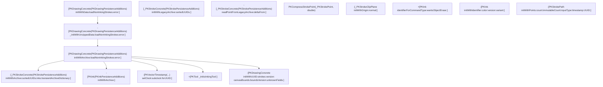
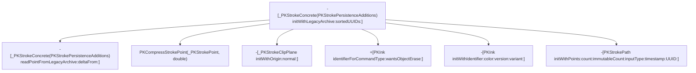

# Per-point auxiliary channels & stroke construction

Continuation of `envelope.md` in this directory, going deeper to try to pin
down the "extra" bytes after each point's X/Y float32 pair in
`Geometry.points` (see `tools/apple-notes-drawing.proto`, which currently
just exposes them as an opaque hex tail per point). Covers three functions,
examined in order, each chosen to settle an open question left by the
previous one - though Function 3 ended up settling a *different* question
than the one it was chosen for (see its section and "Not concluded" below):
it turned out to be genuinely reachable from the real `com.apple.drawing.2`
read path, while Functions 1-2's `initWithLegacyArchive:` tree turned out
never to have been actually confirmed as reachable at all. Read the "Call
graph so far" section at the end first if you want the short version.

## Function 1: `readPointFromLegacyArchive:deltaFrom:`

`-[_PKStrokeConcrete(PKStrokePersistenceAdditions)
readPointFromLegacyArchive:deltaFrom:]`, `PencilKit.framework`, extracted
from the macOS 26.6.2 (25G83) arm64e dyld shared cache via `ipsw dyld
extract`, disassembled via `ipsw macho disass ... --demangle --force`.

### Important caveat before the findings

This function does **not** touch raw bytes or `NSData` at all - no
`getBytes:range:`, no `bytes`/`length` calls, nothing byte-stream shaped.
It operates purely on fixed-offset loads from two already-in-memory C
structs passed in registers (an "archive" point struct and a "delta from"
previous-point struct), and writes a third struct of the same shape by
value (ARM64's indirect-struct-return convention, a hidden pointer argument
ahead of the declared ones).

That means the flat-buffer byte layout the Perl decoder infers empirically
(strides of 12/14/16/18/20/22 bytes per point, first 8 bytes = float32 X/Y)
is **not** explained by this function - something upstream of it must
already unpack the raw `Geometry.points` bytes into these fixed-offset
structs, one per point, before handing them here. That upstream unpacking
is the better target for actually explaining the stride/tail-bytes mystery.
Function 2 below was examined specifically to chase that down; short
version, it isn't the answer either - see its own section.

### What is confirmed about this function

Both input structs carry a one-byte bitmask (loaded from a fixed offset in
the "archive" struct) recording which auxiliary channels are actually
present for that touch/point sample, versus which should fall back to nil.
The function is written as fully-branchless SIMD/FP select logic (no
conditional branches at all): for each output field it computes the
presence bit, and picks between the freshly-read value and a fallback using
`fcsel`/`bsl`-style select instructions rather than an `if`.

There are (at least) two different fallback policies depending on the
field:

- Some fields default to **zero** when their presence bit is unset.
- Others default to **the corresponding field from the "delta from"
  (previous point) struct** when unset - i.e. a carry-forward/delta scheme,
  matching the function's own name.

Three of the output fields are gated by presence-bitmask bit values that
are visible directly as immediate operands in the disassembly (not
inferred from a data dump, so no endianness ambiguity): bit `0x2`, bit
`0x4`, and bit `0x8`. All three use the carry-forward-from-previous-point
fallback. Notably, these three bit values are numerically identical to
Apple's own public, documented `UITouchProperties` option set from
`UIKit/UITouch.h` (`UITouchPropertyAzimuth = 1<<1`, `UITouchPropertyAltitude
= 1<<2`, `UITouchPropertyLocation = 1<<3` - a bitmask iOS has shipped
publicly since iOS 9.1 for describing which properties of a touch sample
are known vs. estimated). That overlap is suggestive - it would make sense
for PencilKit's legacy on-disk format to reuse the same presence-bitmask
convention UIKit already uses at the touch-event level - but it is **not
confirmed**: one of the three fields sized as a single 8-byte scalar lines
up bit-for-bit with `UITouchPropertyLocation`, which in the public API
describes a 2-D point, not a scalar, so either the bit is being reused for
something else in this on-disk encoding, or my field-to-bit pairing has an
off-by-one. `UITouchPropertyForce` (bit `0x1`) is not tested anywhere in
this function at all, for what that's worth.

Two more output fields (each 16 bytes - a pair of doubles) are also
presence-gated, via a vector AND against a small embedded constant rather
than a plain immediate `tst`, so I don't have confident exact bit values
for those two yet. One of the two defaults to zero when absent, the other
to carry-forward, matching the same two-policy pattern as above.

## Function 2: `initWithLegacyArchive:sortedUUIDs:`

`-[_PKStrokeConcrete(PKStrokePersistenceAdditions)
initWithLegacyArchive:sortedUUIDs:]`, same binary, same method (`nm -U
PencilKit | grep initWithLegacyArchive` first to get the exact symbol
spelling - this also shows it's distinct from
`-[PKDrawingConcrete(PKDrawingPersistenceAdditions) initWithLegacyArchive:]`
from `envelope.md`, a different class, no `sortedUUIDs:`).

Examined specifically to answer the open question above ("what calls
`readPointFromLegacyArchive:deltaFrom:`, and does it unpack raw bytes?").
Takes two arguments beyond `self`/`_cmd`: an "archive" object/struct
(*archive* below) and `sortedUUIDs`. Internally follows the standard ObjC
`self = [self init]; ...; return self;` idiom, so the receiver that ends up
populated and returned is a freshly-`init`'d instance, not the raw incoming
`self`.

### (a) Does it call `readPointFromLegacyArchive:deltaFrom:`? Yes.

This is now settled directly, not inferred: the disassembly contains four
separate `objc_msgSend`-dispatched calls whose target selector ipsw resolves
by name as `readPointFromLegacyArchive:deltaFrom:` - one for each of three
special-cased leading points (see below) and one more inside a loop that
handles the remaining points. In every case the receiver (`x0`) is the
newly-`init`'d stroke instance being built by *this* function, matching
Function 1's description of it as an instance method that operates on
already-in-memory point structs via fixed-offset struct-pointer arguments.

### (b) How the points are supplied - and why this still isn't the unpacking stage

This function does **not** touch the raw `Geometry.points` byte buffer,
`NSData`, or any stride/length arithmetic on a byte count. Instead, the
*archive* argument is itself already a struct containing, at a fixed offset
(`+0x40`, paired with an end-pointer at `+0x48`), what reads as a C-style
array of 8-byte pointer-sized elements - the element count is computed as
`(end - begin) / 8`, and the per-point loop indexes into it (index scaled by
8, i.e. pointer-sized entries) to obtain one pointer per point, which is
handed straight into `readPointFromLegacyArchive:deltaFrom:` as the "archive
point" argument for that iteration.

In other words: by the time this function runs, `Geometry.points` has
already been fully unpacked, somewhere upstream, into an array of pointers
to individual fixed-layout point structs. This function just walks that
already-built array. That means the raw-byte/stride-decoding logic
(explaining the observed 12/14/16/18/20/22-byte-per-point strides) is
**still not found** - it must live in whatever code populates this *archive*
struct before calling `initWithLegacyArchive:sortedUUIDs:` at all, i.e. one
level further up the call chain than either function examined so far.

Three points are handled specially, outside the main loop, each via its own
direct call to `readPointFromLegacyArchive:deltaFrom:` reading a point
pointer from its own fixed archive offset rather than from the `+0x40`
array:

- A point at archive offset `+0x8` is read first (if present), using a named
  global constant, `PKStrokePointDefault`, as the "delta from" baseline
  (there being no true previous point yet).
- Two more points, at archive offsets `+0x18` and `+0x20`, are read next and
  are **not** ordinary path points at all - both results feed directly into
  constructing a `-[_PKStrokeClipPlane initWithOrigin:normal:]` object (one
  of the two points supplies the plane origin, the other supplies a normal
  vector whose components are sign-negated relative to the raw read value),
  which is then attached to the stroke via `_setClipPlane:`. This whole
  block is skipped (no clip plane is set) if either archive `+0x18` or
  `+0x20` is null.

The main loop then runs over the `+0x40`/`+0x48` pointer array for the
remaining points, calling `readPointFromLegacyArchive:deltaFrom:` once per
element with the running "previous point" struct as the delta-from
argument (so the delta-from struct is threaded/updated across iterations,
consistent with Function 1's description of it as a carry-forward/delta
decoder). Each result is passed, together with a per-stroke baseline
timestamp value (latched from the very first point and held constant
afterward), to a plain C++ function, `PKCompressStrokePoint` (not an
Objective-C message send), which produces a `PKCompressedStrokePoint`
written into a `std::vector<PKCompressedStrokePoint, ...>` sized exactly to
the point count computed above. That vector's storage is ultimately handed,
along with a freshly-generated identifier, to `-[PKStrokePath
initWithPoints:count:immutableCount:inputType:timestamp:UUID:]`, and the
resulting path object is attached to the stroke via `set_strokeData:`.
`PKCompressStrokePoint` itself was not disassembled (out of scope for this
pass).

### (c) What `sortedUUIDs` is used for

Confirmed from code, not just guessed: `sortedUUIDs` is only ever sent
`count` and `objectAtIndexedSubscript:`. Two integer index values are read
out of the archive struct (one via a field reached through archive `+0x58`,
one via archive `+0x30`) and used as the index argument to
`objectAtIndexedSubscript:` on `sortedUUIDs`, fetching two `NSUUID`-shaped
objects. Each fetched UUID has its raw bytes copied out (via
`getUUIDBytes:`) into a small on-stack struct, which is then handed to
`set_version:` (for the index from `+0x58`) and `set_sortID:` (for the index
from `+0x30`) respectively. Before either lookup happens, the first index is
also bounds-checked against `[sortedUUIDs count]`; if the archive's declared
index is out of bounds, the function abandons construction early and
returns `nil` rather than reading out of range.

So `sortedUUIDs` acts as an interning/lookup table: the archive stores small
integer indices rather than full 16-byte UUIDs inline for these two fields,
and this function resolves them back to real UUID values by indexing into
`sortedUUIDs`. This matches the parameter's name and is a reasonably solid
read of its role, though which specific `.proto`-level field(s) supply those
two indices was not traced past this function's own archive struct.

Separately (and not connected to `sortedUUIDs` at all), the stroke's own
identity UUID and the constructed path's UUID are each produced by sending a
`UUID` selector to a receiver loaded from a fixed global slot that ipsw's
symbol table could not name (no GOT annotation, unlike the several other
class references in this same function that *are* annotated, e.g.
`_OBJC_CLASS_$_PKInk`). The call pattern (a bare class-like reference plus a
zero-argument `UUID` selector, invoked twice to produce two distinct values)
is consistent with `+[NSUUID UUID]` (fresh random UUID generation), but the
receiving class is **not confirmed** by name from this disassembly - flagged
as a guess.

### (d) Other notable archive fields read

- `+0x10`: presence-only flag. If this pointer is null, the stroke is marked
  hidden via `_setHidden:`. If non-null, the *value* actually used for
  `_setBounds:` is not read from the archive at all - it's loaded from a
  fixed global constant (four doubles at a fixed address), i.e. presence of
  `+0x10` merely selects "use a placeholder/default bounds constant" versus
  "mark hidden"; the real per-stroke bounds evidently come from elsewhere
  (possibly computed lazily from the point path afterward - not traced).
- `+0x28`: pointer to a small struct; if present, four `float32` values at
  offset `+0x8` within it are widened to `double` (via `fcvtl`/`fcvtl2`) and
  used as an RGBA-shaped color; if absent, a different embedded global
  constant supplies the fallback color. This color, together with an
  "identifier" derived from an ink command-type field at archive `+0x60` and
  a "version" value (see next), is used to build a `PKInk` object
  (`+[PKInk identifierForCommandType:wantsObjectErase:]` followed by
  `-[PKInk initWithIdentifier:color:version:variant:]`, `variant` hardcoded
  to `0`, `wantsObjectErase` hardcoded to `false`), attached to the stroke
  via `_setInk:`.
- `+0x60`: a 4-byte integer read directly as the "command type" argument to
  `identifierForCommandType:wantsObjectErase:`.
- `+0x38`: only consulted for ink "version" when the just-computed ink
  identifier string is equal to a named constant, `_PKInkIdentifierMarker`
  (a literal, verbatim symbol name seen in the binary's data section). For
  every other ink identifier, version is unconditionally `0`. When the
  identifier *does* match the marker constant: if `+0x38` is null, version
  is `2`; if non-null, version is bit `0x4` (bit index 2) of a byte read at
  offset `+0x14` within the object `+0x38` points to. This is a plausible,
  but not fully confirmed, point of contact with the `.proto`'s
  `StrokeSeqInfo.ink_category` field (observed values 2/3/4, with category 4
  tentatively guessed as "marker" in the decoder) - not proven equivalent
  here, just suggestively adjacent.

Throughout the function, dozens of otherwise-unnamed calls to two recurring
unnamed stub addresses appear around nearly every object handed off or
released, in a pattern consistent with ARC-inserted `objc_retain`/
`objc_release` calls (ipsw's symbol cache did not have names for these
particular stub addresses). Likewise, a global counter value is snapshotted
into a stack slot at function entry and re-checked for equality against its
live value just before the normal return path, branching to an
error/cleanup path on mismatch - the shape of a mutation/consistency guard,
but its exact purpose (e.g. a thread-safety check vs. something
archive-specific) is not confirmed and not pursued further here.

## Function 3: `initWithArchive:loadNonInkingStrokes:error:`

`-[PKDrawingConcrete(PKDrawingPersistenceAdditions)
initWithArchive:loadNonInkingStrokes:error:]`, same binary, same toolchain.
Exact symbol confirmed via `nm -U PencilKit | grep initWithArchive`, which
also turned up several unrelated same-shaped selectors on other classes
(`-[PKInk initWithArchive:]`, `-[PKStroke(Delta) initWithArchive:error:]`,
`-[PKVectorTimestamp(...) initWithArchive:]`,
`-[PKVectorMultiTimestamp(...) initWithArchive:andCapacity:]`,
`-[_PKStrokeConcrete(...) initWithArchive:error:]`, two more
`-[_PKStrokeConcrete(...) initWithArchive:sortedUUIDs:inks:...]` variants,
`-[PKVersionedDocument initWithArchive:]`) - the target was picked by
matching the full selector including `loadNonInkingStrokes:error:`, and its
address is distinct from all of these.

**Reachability from the real path: confirmed yes**, unlike everything else
in this file. `envelope.md` has since been corrected to state this
precisely: `_initWithUnzippedData:loadNonInkingStrokes:error:` makes an
unconditional call into this exact function, passing the just-parsed
`drawing::Drawing` C++ object straight through, immediately after the
protobuf parse succeeds. So Function 3 - not `initWithLegacyArchive:` /
Functions 1-2 above - is the actually-confirmed next stage after envelope
parsing. That reframes what this section originally set out to check: it
was examined on the assumption that it might be the boundary between
"protobuf's view of the data" and the flat C archive-struct tree Functions
1-2 consume, and (per (b) below) it turned out not to be that boundary
either - but it *is* real, on the real path, and Functions 1-2's tree is now
the one whose relevance is in question. See "Not concluded" below.

### (a) Does it call `-[PKDrawingConcrete(PKDrawingPersistenceAdditions) initWithLegacyArchive:]`? No.

Checked exhaustively, not just spot-checked: every `objc_msgSend`-dispatched
call in this function's disassembly was enumerated (ipsw resolves each
target by demangled selector name), and `initWithLegacyArchive:` does not
appear anywhere - nor does the substring "legacy" appear anywhere at all in
the disassembly. So the hypothesized link from this function into the
legacy chain examined in `envelope.md`/Functions 1-2 above is **refuted**,
at least as a direct call.

Instead, this function drives a *different*, non-"Legacy" selector in the
same category: `-[_PKStrokeConcrete(PKStrokePersistenceAdditions)
initWithArchive:sortedUUIDs:inks:transientArchiveDictionary:]` (confirmed
exact symbol, also seen in the `nm` output above), called once per element
of a pointer array read from this function's own `archive` argument at
fixed offset `+0x48`/`+0x50` (begin/end pointer pair, element count
computed as `(end-begin)/8`, i.e. 8-byte pointer-sized entries - the same
begin/end-pointer-pair idiom as Function 2's `+0x40`/`+0x48` array, but at a
different offset and calling a different selector). Each per-stroke archive
element pointer is passed as the `archive:` argument, together with an
`NSOrderedSet` of UUIDs built earlier in this same function (see below) as
`sortedUUIDs:`, an `NSArray` of `PKInk` objects as `inks:`, and an optional
dictionary as `transientArchiveDictionary:`.

Net effect: `initWithArchive:loadNonInkingStrokes:error:` is the entry point
of a structurally parallel, non-"Legacy" persistence tree (the
`initWithArchive:...` family), not a caller of the `initWithLegacyArchive:`
family at all. The two families share idioms (fixed begin/end pointer-pair
arrays, `sortedUUIDs`-index-to-`NSUUID` resolution via `getUUIDBytes:`) but,
at least one level deep, are textually disjoint call graphs.

### (b) Protobuf `drawing::Drawing` access / points stride arithmetic? Not found; this function is at the same abstraction level as the legacy chain, not the protobuf boundary.

This function's `archive` argument is itself already a plain, fixed-offset
C struct - loads at constant offsets `+0x8`, `+0x10`, `+0x18`/`+0x20`,
`+0x30`/`+0x38`, `+0x48`/`+0x50`, `+0x60`, `+0x68`/`+0x70`, `+0x80`, `+0x88`
- with no vtable dispatch, no C++ method calls, and no `getBytes:range:` or
other `NSData`-shaped byte access anywhere. That is the same "already
unpacked into a C struct" shape Functions 1-2 above described for the
legacy chain, not the raw-bytes/vtable-parse shape `envelope.md` described
for the actual protobuf `drawing::Drawing` object. Every array this
function walks (the UUID array at `+0x30`/`+0x38`, the "clock" array at
`+0x68`/`+0x70`, the ink array at `+0x18`/`+0x20`, the stroke array at
`+0x48`/`+0x50`) is iterated with a **fixed** per-element stride (either 8
or 16 bytes) computed once from a begin/end pointer pair - never a
variable, per-element-computed stride. So this function is neither the
`Geometry.points` stride-unpacking site nor a direct reader of the parsed
protobuf message; it's a sibling consumer of some other, already-built
struct tree, one level of abstraction above the raw bytes, same as
Functions 1-2.

### (c) Array/struct construction seen (does not corroborate the legacy chain's struct layout)

The per-stroke pointer array this function walks lives at `archive`
offset `+0x48`/`+0x50` (count via `(end-begin)/8`). That is a **different**
offset from the Drawing-level per-stroke array offset associated with the
legacy chain per the task background (`+0x8`/`+0x10`). Combined with (a) and
(b), this is evidence that the `archive` struct this function consumes is a
structurally distinct type from the one `-[PKDrawingConcrete(
PKDrawingPersistenceAdditions) initWithLegacyArchive:]` consumes, not a
shared representation between the two families - i.e. this function's
construction work does **not** corroborate or explain how the legacy
chain's archive-struct tree gets built.

Besides the stroke array, this function also builds, from other fixed
offsets in its own `archive` struct:

- An `NSOrderedSet` of `NSUUID`s ("sortedUUIDs" - passed on to
  `initWithArchive:sortedUUIDs:inks:transientArchiveDictionary:` as
  described above) from a `+0x30`/`+0x38` pointer-pair array with a 16-byte
  per-element stride; each element's first 8 bytes is read as a pointer to
  a 16-byte UUID buffer handed to `initWithUUIDBytes:`.
- A `PKVectorTimestamp` object (confirmed class reference,
  `_OBJC_CLASS_$_PKVectorTimestamp`) built by repeatedly sending
  `setClock:subclock:forUUID:`, once per element of a `+0x68`/`+0x70`
  pointer array (8-byte stride); each element supplies two numeric fields
  (clock/subclock) plus an index resolved against the `sortedUUIDs`
  ordered set (via `objectAtIndex:`) for the UUID argument - the same
  index-into-`sortedUUIDs` convention Function 2 described at the
  per-stroke level, here reused at the whole-drawing level to build a
  vector-clock-shaped "version" object. This `PKVectorTimestamp` instance
  is later passed as the `version:` argument to this function's own final
  constructor call (see below).
- An `NSArray` of `PKInk` objects (confirmed class reference,
  `_OBJC_CLASS_$_PKInk`) from an `+0x18`/`+0x20` pointer array (8-byte
  stride), via `-[PKInk(PKInkPersistenceAdditions) initWithArchive:]` per
  element - a different, simpler `PKInk` initializer than Function 2's
  `initWithIdentifier:color:version:variant:`.
- An optional dictionary ("transientArchiveDictionary") built only if
  `archive+0x60` is non-null; otherwise passed as `nil`.
- A drawing-level canvas-bounds value: if `archive+0x8` is null, a fixed
  global default-bounds constant is used (matching the same
  default-bounds-constant pattern Function 2 described for stroke-level
  bounds); if non-null, four `float32`s read from an offset within the
  object `archive+0x8` points to are widened to `double` and used as the
  real bounds - i.e. this function *does* show where a real (non-default)
  bounds value can come from at the drawing level, which was left open at
  the stroke level in Function 2's notes (still not resolved there).
- A "boundsVersion"-shaped value: if `archive+0x10` is null, left at its
  zeroed default; if non-null, a 32-bit field is read directly, and a
  64-bit field is checked against the sentinel `0x7fffffffffffffff`
  (`INT64_MAX`) - if equal, an "absent" marker is constructed via a small
  unnamed helper; otherwise the field is used as another `sortedUUIDs`
  index, resolved to a real `NSUUID` via `objectAtIndexedSubscript:`-style
  `objectAtIndex:` plus `getUUIDBytes:` (same idiom as above).
- The drawing's own identity UUID: read directly via `initWithUUIDBytes:`
  from `archive+0x60` if non-null, else generated via a bare `UUID`
  message send to the same unnamed global class reference used for
  `initWithUUIDBytes:` throughout this function - consistent with, but not
  confirmed as, `+[NSUUID UUID]` (same unconfirmed-identity caveat as
  Function 2).

All of the above (drawing UUID, strokes array, `PKVectorTimestamp`
"version", canvas bounds, boundsVersion, plus an "unknownFields"-shaped
struct built from `archive+0x80`/`+0x88` - the latter's `+0x88` slot is
atomically incremented if non-null, matching a C++ `shared_ptr`-style
refcount bump, and is released via `std::__1::__shared_weak_count::
__release_shared` on cleanup paths) are handed to this function's own
receiver via `-[PKDrawingConcrete initWithUUID:strokes:version:
canvasBounds:boundsVersion:unknownFields:]`, whose result is returned (or,
if a mutation-guard snapshot taken at function entry no longer matches a
live global counter at the point of return, an error path is taken instead
via an unnamed helper - the same guard shape flagged unconfirmed in
Function 2's provenance section).

### (d) `loadNonInkingStrokes` and `error` gating

`loadNonInkingStrokes` (a `BOOL`, tested via `tbnz`/bit 0) gates a
per-stroke filter applied only when it is *false*: after constructing each
stroke via `initWithArchive:sortedUUIDs:inks:transientArchiveDictionary:`,
if `loadNonInkingStrokes` is false the function fetches the stroke's `ink`
and sends `+[PKTool(?) _inkIsInkingTool:]` (confirmed class reference,
`_OBJC_CLASS_$_PKTool`) on it; strokes whose ink is not an "inking tool"
are silently dropped from the built strokes array (never added, still
released). If `loadNonInkingStrokes` is true, this filter is skipped
entirely and every constructed stroke is kept. Separately (unrelated to
`loadNonInkingStrokes`): if `archive+0x60` was null (no
transientArchiveDictionary), each constructed stroke is additionally marked
via `_setIsPastedStroke:YES` - a plausible but unconfirmed reading of
`archive+0x60` as "context object identifying a normal load, whose absence
implies loading from a paste/duplicate operation instead."

The `error` out-parameter (`x4` in the ARM64 ObjC calling convention) is
not read or written anywhere in the main body of this function; it is not
observably used on either the success path or the mutation-guard failure
path examined. It may only be populated inside the unnamed error-path
helper called on guard mismatch, which was not itself disassembled.

## Not concluded

- Which auxiliary channel (Function 1) is which (force vs. azimuth vs.
  altitude vs. something PencilKit-internal) beyond the tentative
  `UITouchProperties`-shaped overlap above.
- The exact presence bits for Function 1's two 16-byte (vector) fields.
- **The big one, upgraded from "stride mystery" to "is the whole legacy
  chain even relevant":** `initWithLegacyArchive:` (Functions 1-2's tree)
  has never actually been shown to be called from anywhere on the real
  `com.apple.drawing.2` read path. It was picked in the very first
  investigative session (which produced `envelope.md`) purely because its
  name looked like an obvious next stage after envelope parsing - and that
  assumption was never re-checked before Functions 1-2 here were built on
  top of it. Meanwhile Function 3 (`initWithArchive:
  loadNonInkingStrokes:error:`) *is* now confirmed-reachable from the real
  path (see its section above) and is structurally disjoint from the
  `initWithLegacyArchive:` tree - different archive-struct offsets, calls a
  different per-stroke selector
  (`initWithArchive:sortedUUIDs:inks:transientArchiveDictionary:`, never
  `initWithLegacyArchive:sortedUUIDs:`). So the honest current picture is:
  Functions 1-2 in this file may be a well-documented dead end, same
  situation as `legacy_drawing.md`'s namespace, and the real
  raw-bytes/points-unpacking logic - if it's findable at all this way - more
  plausibly lives somewhere in the `initWithArchive:...` family (Function 3
  and its callee `initWithArchive:sortedUUIDs:inks:
  transientArchiveDictionary:`, not yet disassembled) than in
  `initWithLegacyArchive:sortedUUIDs:`. Not yet resolved either way; the
  original stride-per-point mystery (12-22 bytes) is still open regardless
  of which tree turns out to matter.
- ~~What `-[_PKStrokeConcrete(PKStrokePersistenceAdditions)
  initWithArchive:sortedUUIDs:inks:transientArchiveDictionary:]` (called by
  Function 3) actually does~~ **Resolved, see `point-decode-pipeline.md`**:
  it's a thin wrapper into `initWithArchive:sortedUUIDs:inks:parent:
  isHidden:transientArchiveDictionary:`, which is self-recursive (builds a
  substroke tree) and, for point data specifically, defers through
  `+[PKStrokePath strokeDataFromDataArchive:]` →
  `-[PKStrokePath readStrokeDataFromArchive:]` (where `npts = byte_length /
  stride` is actually computed) → `PKStrokePathPointsShared::
  computeCachedValues()` (builds per-channel size/offset metadata tables,
  `sFieldSizes`/`sFieldOffsets`, explaining the 12-22-byte stride
  mechanism) - though the actual per-point loop that applies that metadata
  across all `npts` points is still not located; see that file's "Not
  concluded".
- Exact identity of the class behind the two `UUID`-selector sends in
  Function 2 (guessed as `+[NSUUID UUID]`, not confirmed by symbol name).
- Where the real (non-placeholder) stroke bounds value used for
  `_setBounds:` actually comes from, given that archive `+0x10` only gates a
  boolean choice between "hidden" and "default global bounds constant."
- Precise mapping from archive `+0x38`'s inner byte/bit to the `.proto`'s
  `StrokeSeqInfo.ink_category`, beyond the suggestive but unconfirmed
  `_PKInkIdentifierMarker` special-case.
- The two unnamed non-`objc_msgSend` helper addresses that immediately
  follow the `PKInk`/color-construction block (invoked as ordinary
  C/C++-calling-convention calls, not selectors) - not identified.

## Provenance

Same source Mac/OS/build and toolchain as `envelope.md` in this directory
(macOS 26.6.2, build 25G83, Apple Silicon T8103; `ipsw` v3.1.714; `otool`
from Xcode Command Line Tools). Method, class, and constant identifiers
referenced above (e.g. `readPointFromLegacyArchive:deltaFrom:`,
`initWithLegacyArchive:sortedUUIDs:`, `PKCompressStrokePoint`,
`PKStrokePointDefault`, `_PKStrokeClipPlane`, `_PKInkIdentifierMarker`,
`PKStrokePath`, `initWithArchive:loadNonInkingStrokes:error:`,
`initWithArchive:sortedUUIDs:inks:transientArchiveDictionary:`,
`_OBJC_CLASS_$_PKVectorTimestamp`, `_OBJC_CLASS_$_PKInk`,
`_OBJC_CLASS_$_PKTool`, `initWithUUID:strokes:version:canvasBounds:
boundsVersion:unknownFields:`) are exact, verbatim symbol/constant names
from that binary's symbol table. The `UITouchProperties` bit values are
public Apple API, not derived from this disassembly. No disassembly, raw
bytes, or extracted binary content is reproduced here or committed to this
repo.

## Call graph so far

Confirmed call edges only - i.e. an actual call/branch instruction was seen
in disassembly (this note's work, or already stated as confirmed in
`envelope.md`) targeting the named selector/function. Guessed or
merely-plausible edges are intentionally omitted.

The first graph is the confirmed-reachable-from-the-real-path subgraph:
`envelope.md` established A --> B, and this file's correction above
established the previously-missing B --> J edge (Function 3). K, L, M, N,
and O were seen only as call targets from J; none of them have been
disassembled themselves yet - `initWithArchive:sortedUUIDs:inks:
transientArchiveDictionary:` (K) is the current top-priority next target,
per "Not concluded" above.

The second graph - `initWithLegacyArchive:sortedUUIDs:` (Function 2) and
everything below it in this file, including `readPointFromLegacyArchive:
deltaFrom:` (Function 1) - is drawn **deliberately disconnected** from the
first, and deliberately not merged with it: despite `envelope.md`'s
original write-up implying otherwise, no confirmed call edge from anything
in the first graph (or anywhere else examined so far) into
`-[PKDrawingConcrete(PKDrawingPersistenceAdditions) initWithLegacyArchive:]`
- the presumed entry point into this whole second subgraph - has actually
been found. Its reachability from the real `com.apple.drawing.2` read path
is therefore unconfirmed, same status as `legacy_drawing.md`'s namespace.
Everything else stated as "confirmed" within Function 1/2's own sections
above (e.g. C2 --> D2) is still accurate as far as it goes - it's only the
connection of this whole subgraph *to the rest of the program* that's now
in question.
