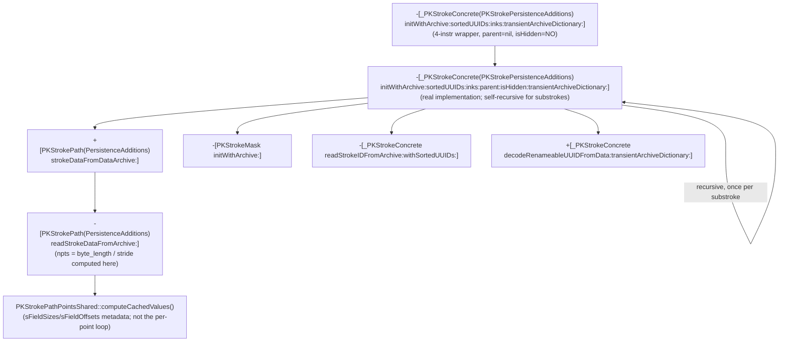

# From per-stroke archive to the stride-decode site

Continuation of `point-fields.md`. That file left `-[_PKStrokeConcrete
(PKStrokePersistenceAdditions) initWithArchive:sortedUUIDs:inks:
transientArchiveDictionary:]` (node K in its call graph) as the top-priority
undisassembled target, being the per-stroke constructor Function 3
(`initWithArchive:loadNonInkingStrokes:error:`) calls once per stroke. This
file disassembles it and follows the concrete call edges it reveals, all the
way down to the actual site that divides a raw byte length by a per-point
stride - the original motivating mystery.

## 1. `initWithArchive:sortedUUIDs:inks:transientArchiveDictionary:` is a thin wrapper

Disassembled via `ipsw macho disass PencilKit -s '-[_PKStrokeConcrete
(PKStrokePersistenceAdditions) initWithArchive:sortedUUIDs:inks:
transientArchiveDictionary:]' --demangle --force`. It is four instructions:
shuffle the incoming `transientArchiveDictionary` argument into position,
zero out two new argument slots, and tail-branch (`b`, not `bl`) into a
longer, distinctly-named selector on the same class:
`-[_PKStrokeConcrete(PKStrokePersistenceAdditions) initWithArchive:
sortedUUIDs:inks:parent:isHidden:transientArchiveDictionary:]`, passing
`parent:` as `nil` and `isHidden:` as `NO`. All the real work - and
everything below - lives in that six-argument selector, confirmed via `nm -U
PencilKit | grep initWithArchive:sortedUUIDs:inks:parent`.

## 2. `initWithArchive:sortedUUIDs:inks:parent:isHidden:transientArchiveDictionary:`

Same binary/toolchain. This function is substantial (~230 instructions plus
ARC exception-landing-pad cleanup blocks) and is **self-recursive** - it
calls itself, by the same six-argument selector, once per "substroke" (see
§2d). Argument registers on entry, and the callee-saved registers they're
moved into for the body: `self`→x26 (unused further; a fresh instance is
`init`'d separately), the per-stroke `archive` struct pointer→x24,
`sortedUUIDs`→x19, `inks`→x20, `parent`→x21 (also spilled to `[sp]`),
`isHidden`→x25, `transientArchiveDictionary`→x22.

### 2a. Entry bounds check

If `archive+0xb0` is non-null, a 32-bit field at `(archive+0xb0)+0x10` is
read as an index and bounds-checked (`b.ls`) against `[sortedUUIDs count]`;
if the index exceeds the count, the function abandons construction
immediately and returns `nil` (same defensive shape `point-fields.md`
described for other archive-index reads). If `archive+0xb0` is null, this
check is skipped entirely.

### 2b. Fields read from `archive` and what they become

A fresh instance is obtained via a plain `[self init]` and used as the
receiver (x23) for the rest of the function, then populated field-by-field.
All offsets below are on this function's own `archive` argument - a
different struct from Function 3's outer per-drawing `archive` (same
begin/end-pointer-pair idiom family, but distinct layout, since these are
per-stroke fields):

- `+0x78`: stroke's own identity UUID. If non-null, an 8-byte pointer to raw
  UUID bytes is read from it and passed to `initWithUUIDBytes:`; if null, a
  fresh UUID is generated (bare `UUID` message send to an unnamed global
  class reference, same unconfirmed-identity pattern noted elsewhere in this
  directory). Result stored via `_setStrokeUUID:`.
- `+0x68`: if non-null, passed together with `sortedUUIDs` to
  `-[_PKStrokeConcrete readStrokeIDFromArchive:withSortedUUIDs:]` (confirmed
  exact selector via `nm`), whose result (a 24-byte value written across two
  stack slots, consistent with a UUID+generation-number pair) is handed to
  `set_sortID:`.
- `+0xb0`: same `readStrokeIDFromArchive:withSortedUUIDs:` call again, result
  passed to `set_version:` instead. (This is the same field already consulted
  for the §2a bounds check, reused here as an actual archive-with-sortedUUIDs
  lookup, not just a bounds probe.)
- `+0xb8`, bit `0x2`: if set, a value at `archive+0x60` is read and passed to
  `_setShapeType:`.
- `+0x28`: if non-null, its first field is passed (along with
  `transientArchiveDictionary`) to `+[_PKStrokeConcrete
  decodeRenameableUUIDFromData:transientArchiveDictionary:]` (a *class*
  method - confirmed by the `_OBJC_CLASS_$__PKStrokeConcrete` receiver load
  immediately before the call), and the result stored via `_setGroupID:`. If
  null, no group ID is set at all (no default-generation fallback, unlike
  most other optional fields here).
- `+0x58`: identical `decodeRenameableUUIDFromData:transientArchiveDictionary:`
  pattern, feeding `_setRenderGroupID:` instead.
- `+0x30` (an "ink index"), gated by bit `0x1` of a flag byte at `+0xb8`:
  bounds-checked against `INT64_MAX` (sentinel "absent") and against
  `[inks count]`; on either failure, an `os_log` diagnostic is emitted
  (subsystem `"com.apple.pencilkit"`, format string `"Archive had invalid ink
  index: %lu"`, read directly as a literal `cstring` operand) and the index
  is treated as invalid rather than aborting construction. When valid, `inks[
  index]` is fetched via `objectAtIndexedSubscript:` and stored via
  `_setInk:`. When invalid *and* `parent` (the recursion argument, see §2d)
  is non-null, the parent stroke's own `ink` (via plain `ink` accessor) is
  used as a fallback instead, with a second `os_log` message ("Unable to find
  ink from saved inkIndex or parent") emitted only if `parent` is *also* nil.
  This is the first concrete evidence in this directory of ink being
  inherited from a parent stroke.
- `+0x20`: if non-null, a `drawing::Rectangle` C++ object is copy-constructed
  from it (`bl drawing::Rectangle::Rectangle(drawing::Rectangle const&)` -
  confirmed C++ symbol, the same `drawing` namespace `envelope.md` describes
  as the real protobuf parse target) and its four `float32`s widened to
  `double` and passed to `_setBounds:`. **This settles a `point-fields.md`
  "Not concluded" item**: real (non-placeholder) per-stroke bounds, at this
  level of the archive tree, come directly from a live `drawing::Rectangle`
  object reachable from the archive - i.e. this per-stroke `archive` struct
  is not purely a flat C struct the way Function 3's was; at least this one
  field is a genuine pointer into the parsed protobuf `drawing::*` object
  tree. If `+0x20` is null, a fixed global default-transform-shaped constant
  is used instead via `_setTransform:` (see next item) rather than a
  separate bounds default - `_setBounds:` is simply not called in that case.
- Transform (`_setTransform:`): a fixed global 6-double constant (presumably
  an identity affine transform) is always set first. Then, if `archive+0xa8`
  is non-null, two `float32` pairs are read from it (widened to `double`,
  NaN-checked per-component via the same `fcmeq`/`bsl` select idiom
  `point-fields.md`'s Function 2 used for color) and `_setTransform:` is
  called again with the real values where valid, default-constant components
  elsewhere. If `archive+0xa8` is null, `parent`'s own `_transform` is copied
  instead (if `parent` is non-nil) - another parent-inheritance fallback.
- Ink transform (`_setInkTransform:`): same NaN-select pattern, reading from
  `archive+0x38`, but only set at all if `archive+0x38` is non-null - no
  parent-fallback branch for this one.
- `+0x80`: raw value copied directly to `_setFlags:`.
- `+0x70`: if non-null, passed to `+[PKStrokePath(PersistenceAdditions)
  strokeDataFromDataArchive:]` and the result stored via `set_strokeData:`
  (see §3 - this is the edge into the actual point-decoding chain). If null,
  `parent`'s own `_strokeData` is copied instead if `parent` is non-nil;
  if both are absent, `strokeData` is left unset.

### 2c. `+0xc0`/`+0xc8`: `unknownFields`, same `shared_ptr` idiom as Function 3

If `archive+0xc0` is non-null, a `std::shared_ptr`-shaped two-word value
(pointer + control block, with an explicit atomic `ldadd` refcount increment
on the control block at `archive+0xc8`) is moved into the new stroke's
`_unknownFields` ivar (located via `OBJC_IVAR_$__PKStrokeConcrete
._unknownFields`, an exact ivar-offset symbol), releasing any previously
held control block via `std::__1::__shared_weak_count::__release_shared`.
Identical shape to Function 3's drawing-level `unknownFields` handling in
`point-fields.md`, just at a different archive offset (`+0xc0`/`+0xc8`
instead of `+0x80`/`+0x88`).

### 2d. Substrokes: this function recurses into itself

`archive+0x88`/`+0x90` is a begin/end pointer-pair array (element count =
byte-length `>> 3`, i.e. 8-byte pointer-sized entries - same idiom as every
other array in this directory). If non-empty:

- `archive+0xa0`, if non-null, feeds `readStrokeIDFromArchive:
  withSortedUUIDs:` into `set_substrokesVersion:`.
- An `NSMutableArray` is allocated with capacity equal to the element count
  and stored via `set_substrokes:`.
- For each element (a per-substroke archive-entry pointer), the function
  inspects a nested pointer-pair at that entry's own `+0x40` offset (empty or
  not) purely to decide the `isHidden:` argument for the recursive call: if
  that nested pair is non-empty, `isHidden` is taken from bit 0 of the outer
  function's own `isHidden` parameter (threaded straight through); if empty,
  `isHidden` is instead taken from bit 0 of the *just-built parent stroke's
  own* `_flags` value. Either way, the function then calls **itself** -
  `-[_PKStrokeConcrete(PKStrokePersistenceAdditions) initWithArchive:
  sortedUUIDs:inks:parent:isHidden:transientArchiveDictionary:]` - passing
  the substroke's archive-entry pointer as `archive:`, the *same*
  `sortedUUIDs`/`inks`/`transientArchiveDictionary` values threaded down
  unchanged, and the just-built stroke (x23, the enclosing call's own result)
  as `parent:`. The returned child stroke, if non-nil, is appended to the
  parent's `substrokes` array via `addObject:`.

This confirms strokes form a recursive tree (substrokes), built by repeated
self-invocation of this one function, with ink/transform/hidden-state
inheritance from parent to child wherever the child's own archive fields are
absent (§2b/§2d above) - a new structural fact not previously documented in
this directory.

### 2e. Stroke mask and mutation guard

`archive+0x40`/`+0x48` (another begin/end pointer pair): if non-empty, a
fresh `_OBJC_CLASS_$_PKStrokeMask` instance is built via `-[PKStrokeMask
initWithArchive:]`, passing the *entire* outer `archive` struct pointer
(not a sub-field) as its own `archive:` argument, and attached via
`_setStrokeMask:`. Not disassembled further.

As in Function 3, a global mutation-counter value is snapshotted at function
entry and re-checked at the normal return point; on mismatch, an
error/cleanup path runs instead of returning the built stroke - same
unconfirmed-purpose guard noted in `point-fields.md`.

## 3. `+[PKStrokePath(PersistenceAdditions) strokeDataFromDataArchive:]`

Three-instruction-plus-boilerplate wrapper: allocs a `PKStrokePath` and
tail-calls `-[PKStrokePath(PersistenceAdditions) readStrokeDataFromArchive:]`
on it with the same archive-field pointer. Confirmed via `nm -U PencilKit |
grep strokeDataFromDataArchive`.

## 4. `-[PKStrokePath(PersistenceAdditions) readStrokeDataFromArchive:]` - the stride-division site

This is the function the whole `point-fields.md` investigation was ultimately
looking for. Its `archive` argument (x20/x2) is a *third*, distinct small
struct (not the per-stroke struct from §2, not Function 3's per-drawing
struct) - call it the "points archive." Offsets below are on it.

- Allocates a fresh, zero-initialized `0x70`-byte block via a
  `malloc_type`-tagged allocator call, wraps it in a `std::shared_ptr<
  PKStrokePathPointsShared>` (confirmed exact C++ type name from the
  demangled `std::__1::shared_ptr<PKStrokePathPointsShared>` constructor
  symbol), and stores that shared_ptr into the `PKStrokePath` instance at
  `self+0x8` (releasing whatever shared_ptr was previously there). The rest
  of this function populates fields of that freshly-allocated
  `PKStrokePathPointsShared` struct (referred to as `shared` below, its raw
  pointer kept in a register across the function) directly.
- `points_archive+0x54` is a one-byte flag field, tested repeatedly via `tst`
  against several bit masks (`0x2`, `0x8`, `0x10`, `0x20`, `0x40`) to gate
  presence of the fields below - same "presence bitmask" idiom used
  throughout this directory, but a fresh, function-local bitmask distinct
  from anything in §2.
  - bit `0x20` gates `points_archive+0x48` (a `double`, else `0.0`) → stored
    to `shared+0x0`.
  - bit `0x40` gates a byte at `points_archive+0x50` (else a hardcoded `1`) →
    stored, narrowed to one bit, to `self+0x60` (a field on the
    `PKStrokePath` object itself, not `shared`).
  - bit `0x8` gates `points_archive+0x30` (a pointer, else `NULL`) → stored to
    `shared+0x20`.
  - bit `0x2`, combined with `points_archive+0x18` being non-null: reads an
    8-byte pointer-and-length pair (`{ptr, len}`) from `*(points_archive
    +0x18)` and appends `len` bytes from `ptr` into a `std::vector<unsigned
    char>` embedded in `shared` at offset `+0x8` (confirmed from the call to
    `std::__1::vector<unsigned char, ...>::__append(unsigned long)`
    immediately followed by a raw copy). `points_archive+0x10` is also
    stashed into `shared+0x28` alongside this.
- **The stride division itself**: if `points_archive+0x20` (a scalar - the
  per-point byte stride) and `points_archive+0x28` (a pointer) are both
  non-null, the function reads an 8-byte length field from
  `*(points_archive+0x28)+0x8`, computes `length / stride` via `udiv`, and
  stores the quotient into `shared+0x30`. This is the exact `npts = byte_length
  / stride` computation `point-fields.md`'s `.proto` comment describes as
  "implicit, not itself a wire-format construct" - now located precisely.
  Separately (same `points_archive+0x28` object), its own `{ptr, len}` pair
  is copied verbatim into a *second*, independent `std::vector<unsigned
  char>`, this one embedded directly on the `PKStrokePath` object itself at
  `self+0x18` (not on `shared`) - i.e. the raw point bytes end up stored in
  two different places for two different purposes.
- `points_archive+0x40`: stroke-path identity UUID, same
  present-bytes-vs-fresh-`UUID` pattern as everywhere else in this
  directory, stored to `self+0x68`.
- Calls `PKStrokePathPointsShared::computeCachedValues()` (confirmed C++
  instance method, non-inlined `bl`) on `shared` - see §5.
- A handful of remaining fields (`points_archive+0x38`/`+0x54` bit `0x10` →
  `self+0x58`; `points_archive+0x8` or, if flag bit `0` is set instead, `self
  _pointsCount` → `self+0x50`; a second `shared_ptr`-shaped pair at
  `points_archive+0x58`/`+0x60` → `self+0x30`) round out the object but were
  not chased further - out of scope for the stride question.
- `self+0x48` is unconditionally set to the sentinel `0x7fefffffffffffff`
  (just under `DBL_MAX`) at the end - plausibly a "cached bounds not yet
  computed" dirty marker, consistent with `point-fields.md`'s open question
  about where lazily-computed stroke bounds come from, though this pass
  cannot confirm what later reads/clears this sentinel.

## 5. `PKStrokePathPointsShared::computeCachedValues()` - per-field size/offset tables, but not the per-point loop

Confirmed C++ symbol (`__ZN24PKStrokePathPointsShared19computeCachedValuesEv`,
demangled directly by `ipsw`), called on `self=shared` from §4. This function
references two data-section tables by name, both resolved directly from
`adrp`/`add` operands (not inferred): `(anonymous namespace)::sFieldSizes`
and `(anonymous namespace)::sFieldOffsets`. Both are indexed by an 11-entry
(`0xb`), 8-byte-stride array (`lsl #3` scaling), addressed by a per-point
"channel index" `0..10`.

- `shared+0x28` (set in §4 only when `points_archive+0x18` was present and
  its bit `0x2` was set) is read as an **11-bit presence bitmask** - one bit
  per optional per-point channel.
- A first loop walks bits `0..10` of that mask; for each set bit `i`, it
  copies `sFieldSizes[i]` bytes from a running cursor into a channel's slot
  at `sFieldOffsets[i]` within a 32-byte on-stack scratch record, advancing
  the read cursor by `sFieldSizes[i]` each time. The read cursor starts at
  the raw-bytes vector built in §4 (`self+0x8`'s vector `begin()`), so this
  is directly consuming the flat per-point tail bytes - but it runs **once**,
  not once per point: the result (32 bytes) is copied into `shared+0x38`/
  `+0x48` as a single fixed record, not multiplied by the point count from
  `shared+0x30`. This reads as building one reference/template record - e.g.
  default values, or a decode key - not decoding the whole points array.
- A second, structurally similar loop walks a *different* 11-bit mask
  (`shared+0x20`, set in §4 from `points_archive+0x30` when present) and
  builds a per-channel cumulative-offset table into an 11-byte array at
  `shared+0x5c`, with the running total (the byte size of a struct containing
  only this second mask's selected channels) stored to `shared+0x58`, and a
  bit-population-style count (same NEON idiom as the first mask) stored to
  `shared+0x68`.

**This confirms the mechanism behind the observed 12/14/16/18/20/22-byte
strides**: a per-path 11-bit channel-presence mask (`shared+0x28`, ultimately
from `points_archive+0x18`'s referenced struct) selects which of up to 11
optional auxiliary channels are packed after each point's X/Y pair, with
fixed per-channel byte widths (`sFieldSizes`) and fixed per-channel offsets
in an in-memory decoded-point record (`sFieldOffsets`) - the sum of the
selected channels' sizes is exactly the "stride minus 8" tail
`point-fields.md` measured empirically. **However, this function itself does
not loop over all `npts` points** - it computes shared per-channel metadata
once. The actual per-point walk that applies this metadata to every point in
the flat buffer (multiplying by `shared+0x30`'s count) is still not located -
see "Not concluded."

`sFieldSizes` and `sFieldOffsets`'s actual numeric contents were **not**
recoverable from the extracted binary file: both addresses
(`0x1eb219438`/`0x1eb2193e0`) fall inside `PencilKit`'s `__DATA,__common`
section, a zerofill/BSS-class section with no on-disk file backing
(`otool -l` shows `offset 0` for it) - i.e. these tables are populated by a
runtime static initializer, not compiled-in constant data, so `dd`-based
static extraction (the technique `legacy_drawing.md` used for a jump table)
does not apply here; reading them would require a live memory read, out of
this project's static-disassembly-only scope.

## Not concluded

- The actual per-point iteration that applies `sFieldSizes`/`sFieldOffsets`
  (or the `shared+0x5c` cumulative-offset table) to every point in the
  `shared+0x8` raw-bytes vector, `shared+0x30` times - not located. Likely
  candidates: `PKStrokePathPointsShared::updateFromCachedValues()` (confirmed
  sibling symbol, `__ZN24PKStrokePathPointsShared22updateFromCachedValuesEv`,
  not disassembled this pass) or an on-demand point-accessor method on
  `PKStrokePath` itself.
- Numeric contents of `sFieldSizes`/`sFieldOffsets` (which channel is which
  size, in what order) - unrecoverable from static binary analysis per §5's
  closing paragraph; would need a live process/memory read, which is out of
  this project's scope (SIP-enabled source Mac, static disassembly only).
- What the two independent 11-bit masks (`shared+0x28` from
  `points_archive+0x18`, `shared+0x20` from `points_archive+0x30`) actually
  mean relative to each other - one reads as "which channels are present on
  disk," the other as "which channels the caller wants materialized," but
  this is inferred from shape, not confirmed by any named field.
- `-[_PKStrokeConcrete readStrokeIDFromArchive:withSortedUUIDs:]` - called
  from three sites in §2b/§2d, confirmed exact selector, not itself
  disassembled; its 24-byte result shape (UUID-sized value across two stack
  slots) is inferred from the caller's stack layout only.
- `-[PKStrokeMask initWithArchive:]`, `+[_PKStrokeConcrete
  decodeRenameableUUIDFromData:transientArchiveDictionary:]` - confirmed call
  targets, not disassembled.
- Whether `points_archive` (§4's argument) is populated from the same parsed
  `drawing::Drawing` C++ tree §2b's `drawing::Rectangle` bounds field came
  from, i.e. whether it's a pointer straight into `Geometry.points`'s parsed
  protobuf representation or something already copied out - not traced back
  further than `-[_PKStrokeConcrete(...) initWithArchive:sortedUUIDs:inks:
  parent:isHidden:transientArchiveDictionary:]`'s own `archive+0x70` field
  (§2b), which is where `points_archive` (this function's `archive`
  argument) actually comes from.

## Provenance

Same source Mac/OS/build and toolchain as the other files in this directory
(macOS 26.6.2, build 25G83, Apple Silicon T8103; `ipsw` v3.1.714; `otool`
from Xcode Command Line Tools; `nm`). Additionally used `otool -l` (segment/
section listing) to determine that `sFieldSizes`/`sFieldOffsets` live in a
zerofill section, and attempted (`dd`, ultimately non-conclusive per §5) to
read their file-backed bytes. Method, class, C++ symbol, and constant
identifiers referenced above (e.g. `initWithArchive:sortedUUIDs:inks:parent:
isHidden:transientArchiveDictionary:`, `readStrokeIDFromArchive:
withSortedUUIDs:`, `decodeRenameableUUIDFromData:transientArchiveDictionary:`,
`drawing::Rectangle::Rectangle`, `OBJC_IVAR_$__PKStrokeConcrete
._unknownFields`, `strokeDataFromDataArchive:`, `readStrokeDataFromArchive:`,
`PKStrokePathPointsShared`, `computeCachedValues`, `updateFromCachedValues`,
`sFieldSizes`, `sFieldOffsets`) are exact, verbatim symbol names from
`PencilKit.framework`'s symbol table/disassembly, extracted from the macOS
26.6.2 (25G83) arm64e dyld shared cache in a prior session (not re-extracted
here). The two `os_log` literal strings ("Archive had invalid ink index:
%lu", "Unable to find ink from saved inkIndex or parent") are exact, verbatim
string constants read directly as instruction operands. No disassembly, raw
bytes, or extracted binary content is reproduced here or committed to this
repo.

## Call graph (this file's additions)

Confirmed call edges only, extending `point-fields.md`'s graph from node K.

`K` is the same node `K` in `point-fields.md`'s call graph. This file
resolves it fully and shows it bottoms out, for point data specifically, at
`computeCachedValues()` - which itself defers the real per-point stride walk
to a still-unidentified caller of `updateFromCachedValues()` or an on-demand
accessor (see "Not concluded").
