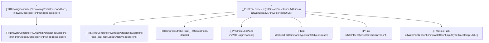

# Per-point auxiliary channels & stroke construction

Continuation of `envelope.md` in this directory, going two functions deeper
to try to pin down the "extra" bytes after each point's X/Y float32 pair in
`Geometry.points` (see `tools/apple-notes-drawing.proto`, which currently
just exposes them as an opaque hex tail per point). Covers two functions,
examined in order, because the second was needed to settle an open question
left by the first.

## Function 1: `readPointFromLegacyArchive:deltaFrom:`

`-[_PKStrokeConcrete(PKStrokePersistenceAdditions)
readPointFromLegacyArchive:deltaFrom:]`, `PencilKit.framework`, extracted
from the macOS 26.6.2 (25G83) arm64e dyld shared cache via `ipsw dyld
extract`, disassembled via `ipsw macho disass ... --demangle --force`.

### Important caveat before the findings

This function does **not** touch raw bytes or `NSData` at all - no
`getBytes:range:`, no `bytes`/`length` calls, nothing byte-stream shaped.
It operates purely on fixed-offset loads from two already-in-memory C
structs passed in registers (an "archive" point struct and a "delta from"
previous-point struct), and writes a third struct of the same shape by
value (ARM64's indirect-struct-return convention, a hidden pointer argument
ahead of the declared ones).

That means the flat-buffer byte layout the Perl decoder infers empirically
(strides of 12/14/16/18/20/22 bytes per point, first 8 bytes = float32 X/Y)
is **not** explained by this function - something upstream of it must
already unpack the raw `Geometry.points` bytes into these fixed-offset
structs, one per point, before handing them here. That upstream unpacking
is the better target for actually explaining the stride/tail-bytes mystery.
Function 2 below was examined specifically to chase that down; short
version, it isn't the answer either - see its own section.

### What is confirmed about this function

Both input structs carry a one-byte bitmask (loaded from a fixed offset in
the "archive" struct) recording which auxiliary channels are actually
present for that touch/point sample, versus which should fall back to nil.
The function is written as fully-branchless SIMD/FP select logic (no
conditional branches at all): for each output field it computes the
presence bit, and picks between the freshly-read value and a fallback using
`fcsel`/`bsl`-style select instructions rather than an `if`.

There are (at least) two different fallback policies depending on the
field:

- Some fields default to **zero** when their presence bit is unset.
- Others default to **the corresponding field from the "delta from"
  (previous point) struct** when unset - i.e. a carry-forward/delta scheme,
  matching the function's own name.

Three of the output fields are gated by presence-bitmask bit values that
are visible directly as immediate operands in the disassembly (not
inferred from a data dump, so no endianness ambiguity): bit `0x2`, bit
`0x4`, and bit `0x8`. All three use the carry-forward-from-previous-point
fallback. Notably, these three bit values are numerically identical to
Apple's own public, documented `UITouchProperties` option set from
`UIKit/UITouch.h` (`UITouchPropertyAzimuth = 1<<1`, `UITouchPropertyAltitude
= 1<<2`, `UITouchPropertyLocation = 1<<3` - a bitmask iOS has shipped
publicly since iOS 9.1 for describing which properties of a touch sample
are known vs. estimated). That overlap is suggestive - it would make sense
for PencilKit's legacy on-disk format to reuse the same presence-bitmask
convention UIKit already uses at the touch-event level - but it is **not
confirmed**: one of the three fields sized as a single 8-byte scalar lines
up bit-for-bit with `UITouchPropertyLocation`, which in the public API
describes a 2-D point, not a scalar, so either the bit is being reused for
something else in this on-disk encoding, or my field-to-bit pairing has an
off-by-one. `UITouchPropertyForce` (bit `0x1`) is not tested anywhere in
this function at all, for what that's worth.

Two more output fields (each 16 bytes - a pair of doubles) are also
presence-gated, via a vector AND against a small embedded constant rather
than a plain immediate `tst`, so I don't have confident exact bit values
for those two yet. One of the two defaults to zero when absent, the other
to carry-forward, matching the same two-policy pattern as above.

## Function 2: `initWithLegacyArchive:sortedUUIDs:`

`-[_PKStrokeConcrete(PKStrokePersistenceAdditions)
initWithLegacyArchive:sortedUUIDs:]`, same binary, same method (`nm -U
PencilKit | grep initWithLegacyArchive` first to get the exact symbol
spelling - this also shows it's distinct from
`-[PKDrawingConcrete(PKDrawingPersistenceAdditions) initWithLegacyArchive:]`
from `envelope.md`, a different class, no `sortedUUIDs:`).

Examined specifically to answer the open question above ("what calls
`readPointFromLegacyArchive:deltaFrom:`, and does it unpack raw bytes?").
Takes two arguments beyond `self`/`_cmd`: an "archive" object/struct
(*archive* below) and `sortedUUIDs`. Internally follows the standard ObjC
`self = [self init]; ...; return self;` idiom, so the receiver that ends up
populated and returned is a freshly-`init`'d instance, not the raw incoming
`self`.

### (a) Does it call `readPointFromLegacyArchive:deltaFrom:`? Yes.

This is now settled directly, not inferred: the disassembly contains four
separate `objc_msgSend`-dispatched calls whose target selector ipsw resolves
by name as `readPointFromLegacyArchive:deltaFrom:` - one for each of three
special-cased leading points (see below) and one more inside a loop that
handles the remaining points. In every case the receiver (`x0`) is the
newly-`init`'d stroke instance being built by *this* function, matching
Function 1's description of it as an instance method that operates on
already-in-memory point structs via fixed-offset struct-pointer arguments.

### (b) How the points are supplied - and why this still isn't the unpacking stage

This function does **not** touch the raw `Geometry.points` byte buffer,
`NSData`, or any stride/length arithmetic on a byte count. Instead, the
*archive* argument is itself already a struct containing, at a fixed offset
(`+0x40`, paired with an end-pointer at `+0x48`), what reads as a C-style
array of 8-byte pointer-sized elements - the element count is computed as
`(end - begin) / 8`, and the per-point loop indexes into it (index scaled by
8, i.e. pointer-sized entries) to obtain one pointer per point, which is
handed straight into `readPointFromLegacyArchive:deltaFrom:` as the "archive
point" argument for that iteration.

In other words: by the time this function runs, `Geometry.points` has
already been fully unpacked, somewhere upstream, into an array of pointers
to individual fixed-layout point structs. This function just walks that
already-built array. That means the raw-byte/stride-decoding logic
(explaining the observed 12/14/16/18/20/22-byte-per-point strides) is
**still not found** - it must live in whatever code populates this *archive*
struct before calling `initWithLegacyArchive:sortedUUIDs:` at all, i.e. one
level further up the call chain than either function examined so far.

Three points are handled specially, outside the main loop, each via its own
direct call to `readPointFromLegacyArchive:deltaFrom:` reading a point
pointer from its own fixed archive offset rather than from the `+0x40`
array:

- A point at archive offset `+0x8` is read first (if present), using a named
  global constant, `PKStrokePointDefault`, as the "delta from" baseline
  (there being no true previous point yet).
- Two more points, at archive offsets `+0x18` and `+0x20`, are read next and
  are **not** ordinary path points at all - both results feed directly into
  constructing a `-[_PKStrokeClipPlane initWithOrigin:normal:]` object (one
  of the two points supplies the plane origin, the other supplies a normal
  vector whose components are sign-negated relative to the raw read value),
  which is then attached to the stroke via `_setClipPlane:`. This whole
  block is skipped (no clip plane is set) if either archive `+0x18` or
  `+0x20` is null.

The main loop then runs over the `+0x40`/`+0x48` pointer array for the
remaining points, calling `readPointFromLegacyArchive:deltaFrom:` once per
element with the running "previous point" struct as the delta-from
argument (so the delta-from struct is threaded/updated across iterations,
consistent with Function 1's description of it as a carry-forward/delta
decoder). Each result is passed, together with a per-stroke baseline
timestamp value (latched from the very first point and held constant
afterward), to a plain C++ function, `PKCompressStrokePoint` (not an
Objective-C message send), which produces a `PKCompressedStrokePoint`
written into a `std::vector<PKCompressedStrokePoint, ...>` sized exactly to
the point count computed above. That vector's storage is ultimately handed,
along with a freshly-generated identifier, to `-[PKStrokePath
initWithPoints:count:immutableCount:inputType:timestamp:UUID:]`, and the
resulting path object is attached to the stroke via `set_strokeData:`.
`PKCompressStrokePoint` itself was not disassembled (out of scope for this
pass).

### (c) What `sortedUUIDs` is used for

Confirmed from code, not just guessed: `sortedUUIDs` is only ever sent
`count` and `objectAtIndexedSubscript:`. Two integer index values are read
out of the archive struct (one via a field reached through archive `+0x58`,
one via archive `+0x30`) and used as the index argument to
`objectAtIndexedSubscript:` on `sortedUUIDs`, fetching two `NSUUID`-shaped
objects. Each fetched UUID has its raw bytes copied out (via
`getUUIDBytes:`) into a small on-stack struct, which is then handed to
`set_version:` (for the index from `+0x58`) and `set_sortID:` (for the index
from `+0x30`) respectively. Before either lookup happens, the first index is
also bounds-checked against `[sortedUUIDs count]`; if the archive's declared
index is out of bounds, the function abandons construction early and
returns `nil` rather than reading out of range.

So `sortedUUIDs` acts as an interning/lookup table: the archive stores small
integer indices rather than full 16-byte UUIDs inline for these two fields,
and this function resolves them back to real UUID values by indexing into
`sortedUUIDs`. This matches the parameter's name and is a reasonably solid
read of its role, though which specific `.proto`-level field(s) supply those
two indices was not traced past this function's own archive struct.

Separately (and not connected to `sortedUUIDs` at all), the stroke's own
identity UUID and the constructed path's UUID are each produced by sending a
`UUID` selector to a receiver loaded from a fixed global slot that ipsw's
symbol table could not name (no GOT annotation, unlike the several other
class references in this same function that *are* annotated, e.g.
`_OBJC_CLASS_$_PKInk`). The call pattern (a bare class-like reference plus a
zero-argument `UUID` selector, invoked twice to produce two distinct values)
is consistent with `+[NSUUID UUID]` (fresh random UUID generation), but the
receiving class is **not confirmed** by name from this disassembly - flagged
as a guess.

### (d) Other notable archive fields read

- `+0x10`: presence-only flag. If this pointer is null, the stroke is marked
  hidden via `_setHidden:`. If non-null, the *value* actually used for
  `_setBounds:` is not read from the archive at all - it's loaded from a
  fixed global constant (four doubles at a fixed address), i.e. presence of
  `+0x10` merely selects "use a placeholder/default bounds constant" versus
  "mark hidden"; the real per-stroke bounds evidently come from elsewhere
  (possibly computed lazily from the point path afterward - not traced).
- `+0x28`: pointer to a small struct; if present, four `float32` values at
  offset `+0x8` within it are widened to `double` (via `fcvtl`/`fcvtl2`) and
  used as an RGBA-shaped color; if absent, a different embedded global
  constant supplies the fallback color. This color, together with an
  "identifier" derived from an ink command-type field at archive `+0x60` and
  a "version" value (see next), is used to build a `PKInk` object
  (`+[PKInk identifierForCommandType:wantsObjectErase:]` followed by
  `-[PKInk initWithIdentifier:color:version:variant:]`, `variant` hardcoded
  to `0`, `wantsObjectErase` hardcoded to `false`), attached to the stroke
  via `_setInk:`.
- `+0x60`: a 4-byte integer read directly as the "command type" argument to
  `identifierForCommandType:wantsObjectErase:`.
- `+0x38`: only consulted for ink "version" when the just-computed ink
  identifier string is equal to a named constant, `_PKInkIdentifierMarker`
  (a literal, verbatim symbol name seen in the binary's data section). For
  every other ink identifier, version is unconditionally `0`. When the
  identifier *does* match the marker constant: if `+0x38` is null, version
  is `2`; if non-null, version is bit `0x4` (bit index 2) of a byte read at
  offset `+0x14` within the object `+0x38` points to. This is a plausible,
  but not fully confirmed, point of contact with the `.proto`'s
  `StrokeSeqInfo.ink_category` field (observed values 2/3/4, with category 4
  tentatively guessed as "marker" in the decoder) - not proven equivalent
  here, just suggestively adjacent.

Throughout the function, dozens of otherwise-unnamed calls to two recurring
unnamed stub addresses appear around nearly every object handed off or
released, in a pattern consistent with ARC-inserted `objc_retain`/
`objc_release` calls (ipsw's symbol cache did not have names for these
particular stub addresses). Likewise, a global counter value is snapshotted
into a stack slot at function entry and re-checked for equality against its
live value just before the normal return path, branching to an
error/cleanup path on mismatch - the shape of a mutation/consistency guard,
but its exact purpose (e.g. a thread-safety check vs. something
archive-specific) is not confirmed and not pursued further here.

## Not concluded

- Which auxiliary channel (Function 1) is which (force vs. azimuth vs.
  altitude vs. something PencilKit-internal) beyond the tentative
  `UITouchProperties`-shaped overlap above.
- The exact presence bits for Function 1's two 16-byte (vector) fields.
- The raw-byte unpacking of `Geometry.points` into the pointer array
  Function 2 consumes at archive `+0x40`/`+0x48` - still not located. The
  stride-per-point mystery (12-22 bytes) is therefore still open; Function 2
  conclusively rules itself out as the place to look, but does not identify
  the actual place. The next candidate would be whatever function
  constructs the *archive* argument passed into
  `initWithLegacyArchive:sortedUUIDs:` in the first place (i.e. its
  caller), not yet examined.
- Exact identity of the class behind the two `UUID`-selector sends in
  Function 2 (guessed as `+[NSUUID UUID]`, not confirmed by symbol name).
- Where the real (non-placeholder) stroke bounds value used for
  `_setBounds:` actually comes from, given that archive `+0x10` only gates a
  boolean choice between "hidden" and "default global bounds constant."
- Precise mapping from archive `+0x38`'s inner byte/bit to the `.proto`'s
  `StrokeSeqInfo.ink_category`, beyond the suggestive but unconfirmed
  `_PKInkIdentifierMarker` special-case.
- The two unnamed non-`objc_msgSend` helper addresses that immediately
  follow the `PKInk`/color-construction block (invoked as ordinary
  C/C++-calling-convention calls, not selectors) - not identified.

## Provenance

Same source Mac/OS/build and toolchain as `envelope.md` in this directory
(macOS 26.6.2, build 25G83, Apple Silicon T8103; `ipsw` v3.1.714; `otool`
from Xcode Command Line Tools). Method, class, and constant identifiers
referenced above (e.g. `readPointFromLegacyArchive:deltaFrom:`,
`initWithLegacyArchive:sortedUUIDs:`, `PKCompressStrokePoint`,
`PKStrokePointDefault`, `_PKStrokeClipPlane`, `_PKInkIdentifierMarker`,
`PKStrokePath`) are exact, verbatim symbol/constant names from that
binary's symbol table. The `UITouchProperties` bit values are public Apple
API, not derived from this disassembly. No disassembly, raw bytes, or
extracted binary content is reproduced here or committed to this repo.

## Call graph so far

Confirmed call edges only - i.e. an actual call/branch instruction was seen
in disassembly (this note's work, or already stated as confirmed in
`envelope.md`) targeting the named selector/function. Guessed or
merely-plausible edges are intentionally omitted.

Note: `readPointFromLegacyArchive:deltaFrom:` has no confirmed outgoing
edges of its own - it's pure fixed-offset struct arithmetic with no further
calls of interest. `PKCompressStrokePoint`, `-[_PKStrokeClipPlane
initWithOrigin:normal:]`, `+[PKInk identifierForCommandType:
wantsObjectErase:]`, `-[PKInk initWithIdentifier:color:version:variant:]`,
and `-[PKStrokePath
initWithPoints:count:immutableCount:inputType:timestamp:UUID:]` were seen
only as call targets from `initWithLegacyArchive:sortedUUIDs:` - none of
them have been disassembled themselves yet. Separately, `envelope.md`
already established `-[PKDrawingConcrete(PKDrawingPersistenceAdditions)
initWithLegacyArchive:]` calling `-[_PKStrokeConcrete(
PKStrokePersistenceAdditions) initWithLegacyArchive:sortedUUIDs:]` (node C
above) in a per-stroke loop - not redrawn here to keep the diagram
readable, see `envelope.md` for that edge.
